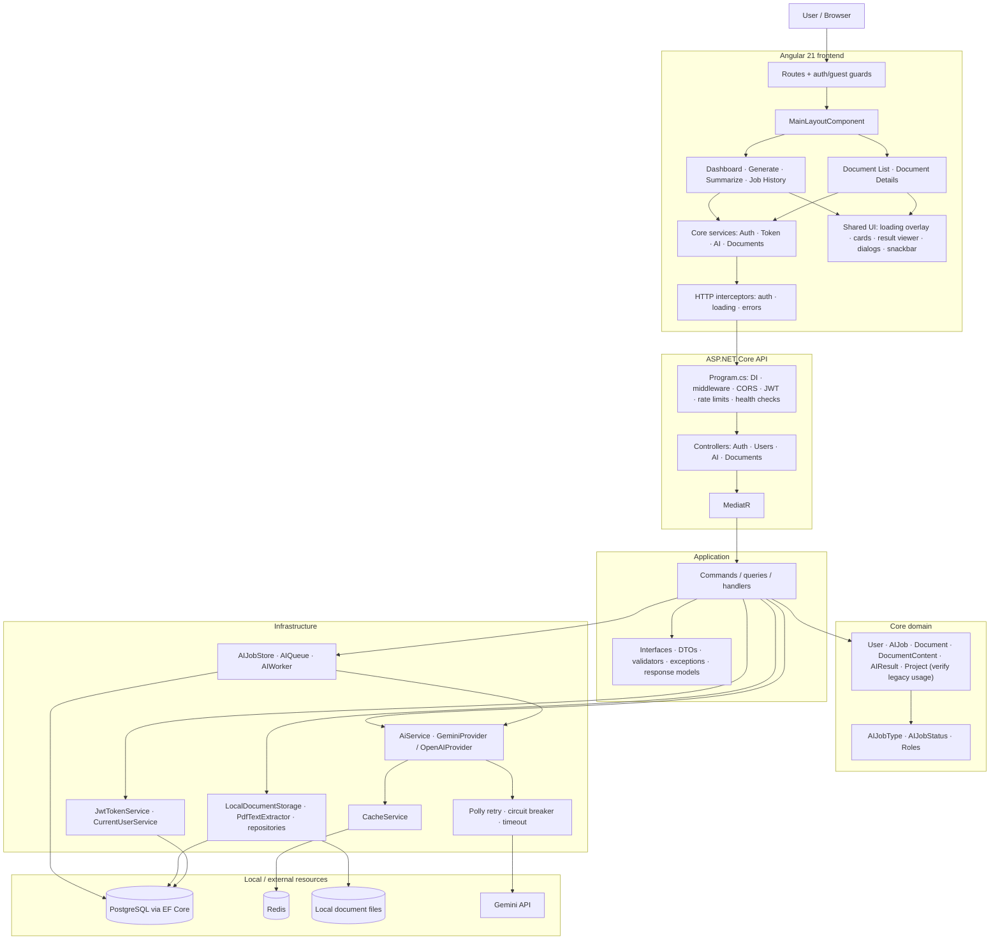
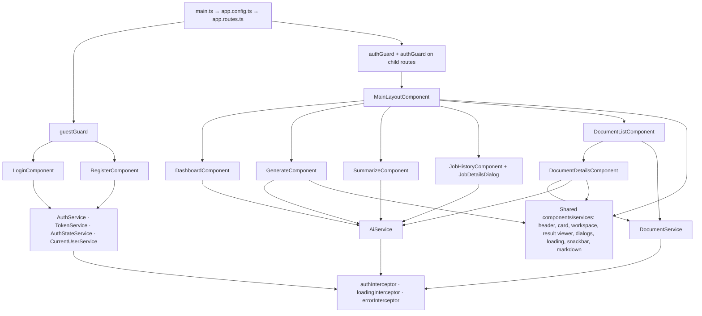
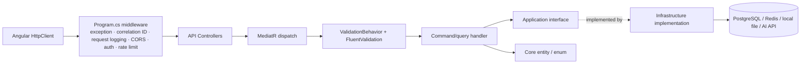
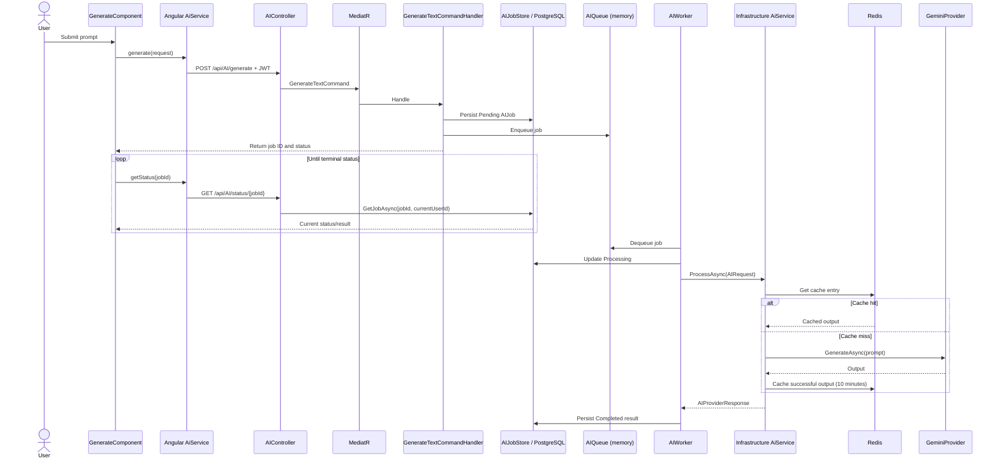
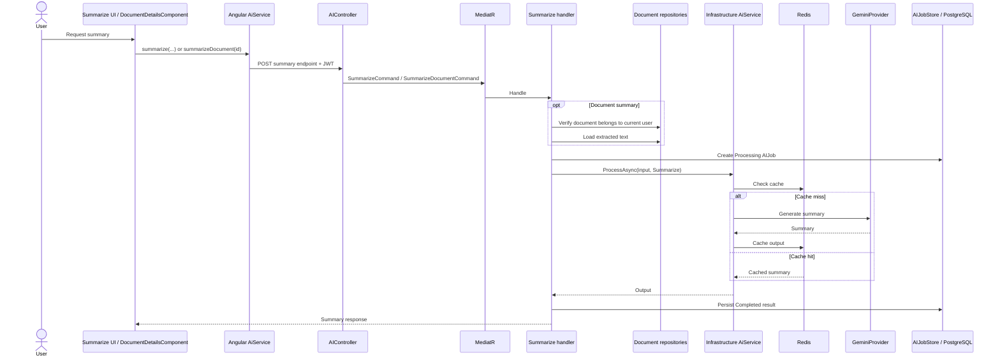
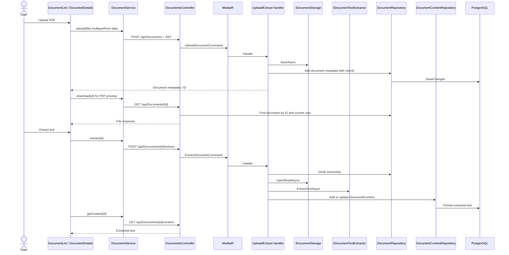
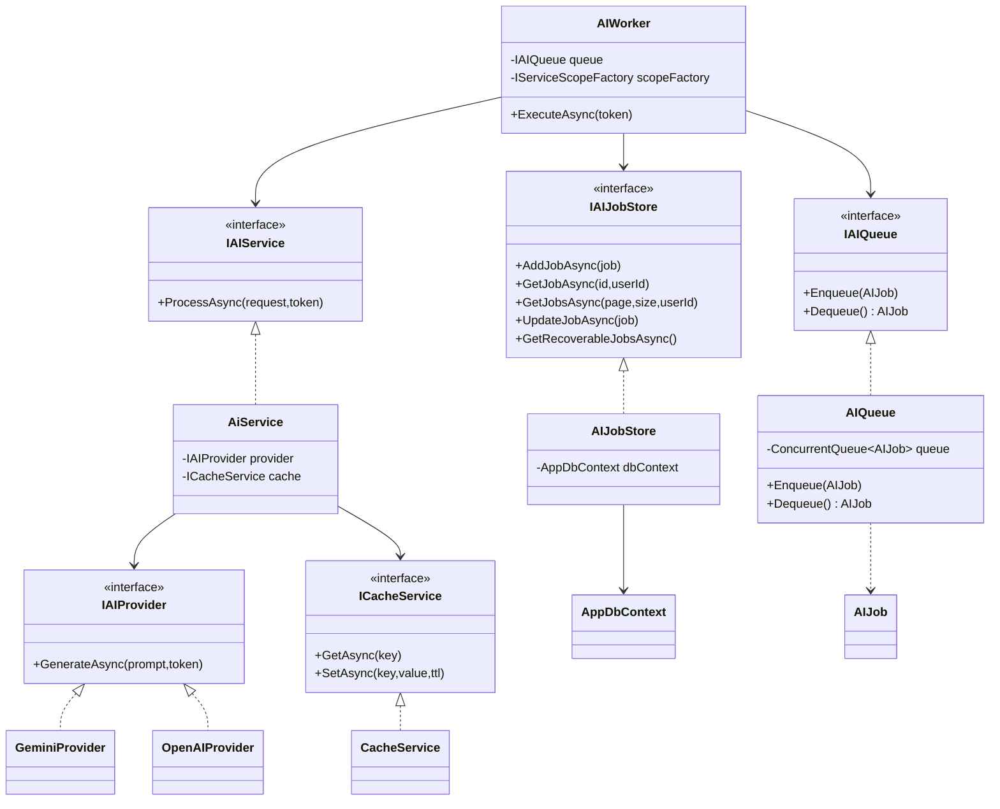
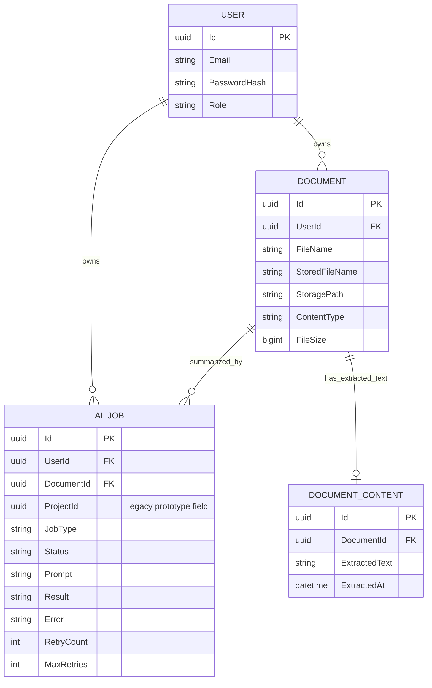

# Smart AI Dashboard — Architecture Blueprint

> **Living source of truth.** Start here before changing architecture, implementing a feature, or beginning cloud deployment. Update this document whenever implementation changes. Diagrams describe the repository at the baseline commit listed below; re-check source before treating them as current after code changes.

- Repository: [Aminafia/Smart-AI-Dashboard](https://github.com/Aminafia/Smart-AI-Dashboard)
- Baseline branch: `main`
- Baseline commit: `1ecdb51be7c74f9a78f664d61110bb45479a1f5e`
- Tracked files at baseline: **361**
- **Baseline metadata note:** the commit and file count above are a historical snapshot, not a live `main` status. For current structural inventory, use [`docs/generated/SOURCE_INVENTORY.md`](generated/SOURCE_INVENTORY.md) and [`docs/generated/DOTNET_PROJECT_DEPENDENCIES.md`](generated/DOTNET_PROJECT_DEPENDENCIES.md); regenerate/check them with `python scripts/check_architecture_docs.py --write` and `python scripts/check_architecture_docs.py --check`. The reviewed workflow diagrams below remain human-maintained and must be checked against source after implementation changes.
- Purpose: map system boundaries, execution paths, dependencies, persistence, and code-file locations.
- Important limit: diagrams summarize and connect source files; they do not replace source code. The inventory at the end makes tracked files discoverable. Individual implementation details must be verified against each linked source file.
- End-to-end workflow handbook: [docs/WORKFLOW_UML_HANDBOOK.md](WORKFLOW_UML_HANDBOOK.md) — master walkthrough, shared middleware/security foundation, sequence diagrams, participating-file registers, and verification checklists.

## 1. Locked-in product and architecture decisions

**Execution tracking:** the workflow-level source trace is in [`WORKFLOW_UML_HANDBOOK.md`](WORKFLOW_UML_HANDBOOK.md); prioritized fixes and the final verification order are in [`STABILIZATION_BACKLOG.md`](STABILIZATION_BACKLOG.md).

1. This is **one Smart AI Dashboard application** with a shared frontend and backend, not a collection of separately managed AI projects.
2. `ProjectId` in `AIJob` and the `Project` entity are legacy prototype concepts. Do not add project-management features to justify them. Trace references, then remove obsolete fields/entities with a safe EF Core migration after confirming no functional dependencies.
3. Text generation is asynchronous because it can take longer: persist job, enqueue, process in `AIWorker`, persist status/result, poll status.
4. Text and document summarization are currently synchronous: call the AI service in the request handler and return the result. This is intentional for current workloads.
5. Local queue/storage are acceptable for local development. Cloud evolution is planned, not a reason for premature redesign: local files → S3; in-memory queue → SQS; containerized API/worker; managed database/cache as selected during deployment design.
6. Finish code consistency and essential end-to-end verification before deployment. Keep the implementation simple; no Kubernetes, Kafka, or microservice split unless a demonstrated requirement justifies it.

## 2. Level 0 — Master system map

### Layer rules

- **Frontend:** route and view state; calls REST endpoints through typed services.
- **API:** HTTP boundary, middleware, auth configuration, routing, status codes and request/response serialization.
- **Application:** use-case orchestration through MediatR; depends on abstractions, not concrete storage/provider implementations.
- **Core:** domain entities and enums.
- **Infrastructure:** implementations of interfaces, EF Core, file storage, AI provider, Redis, resilience and worker.
- **External resources:** PostgreSQL, Redis and Gemini are separate runtime dependencies. Local files and in-memory queue are current local implementations.

## 3. Level 1 — Frontend route and service map

Routes defined in `frontend/src/app/app.routes.ts`:
- `/login`, `/register` — guest guarded.
- `/dashboard`, `/ai/generate`, `/summarize`, `/ai/jobs`, `/documents`, `/documents/:id` — authenticated layout.
- Unknown routes redirect to dashboard.

Key frontend source areas:
- App bootstrap/config: `frontend/src/main.ts`, `frontend/src/app/app.config.ts`, `frontend/src/app/app.routes.ts`.
- Core infrastructure: `frontend/src/app/core/guards/`, `core/interceptors/`, `core/services/`, `core/models/`.
- Features: `frontend/src/app/features/auth/`, `features/ai/`, `features/dashboard/`, `features/documents/`.
- Shared presentation: `frontend/src/app/shared/components/`, `frontend/src/app/shared/services/`.
- Environment/build: `frontend/src/environments/`, `frontend/angular.json`, `frontend/package.json`, `frontend/tsconfig.json`, `frontend/tsconfig.app.json`, `frontend/tsconfig.spec.json`, `frontend/src/styles.css`, `frontend/src/material-theme.scss`.

## 4. Level 1 — Backend dependency and request map

Registration and bootstrap:
- `backend/API/Program.cs`: web host, logging, controllers, JSON enum conversion, Swagger, application/infrastructure/auth/health-check registrations, CORS, Redis cache registration, rate limiting, middleware pipeline, controller mapping.
- `backend/Application/DependencyInjection.cs`: MediatR handlers, FluentValidation validators, validation pipeline behavior.
- `backend/Infrastructure/DependencyInjection.cs`: EF Core/Npgsql, repositories, current-user service, local document storage, PDF extractor, AI service/provider, JWT service, cache service, HttpClient resilience policies, singleton in-memory queue and hosted AI worker.
- `backend/Infrastructure/Data/AppDbContext.cs`: entity sets, enum-to-string conversions, indexes and one-to-one document-content relation.

### Controller endpoint map (verify contracts against current source)

| Controller | Route | Purpose |
|---|---|---|
| AuthController | `POST /api/auth/login` | Validate credentials and issue JWT |
| AuthController | `POST /api/auth/register` | Register account |
| UsersController | `GET /api/users` | Admin-only user listing |
| UsersController | `POST /api/users` | Admin-only user creation |
| AIController | `POST /api/AI/generate` | Create queued generation job |
| AIController | `GET /api/AI/status/{jobId}` | Retrieve current user's job status/result |
| AIController | `GET /api/AI/jobs` | Paginated current user's jobs |
| AIController | `POST /api/AI/summarize` | Synchronous plain-text summary |
| AIController | `POST /api/AI/documents/{documentId}/summarize` | Synchronous document summary |
| AIController | `GET /api/AI/stats` | Current user's job statistics |
| AIController | `GET /api/AI/documents/{documentId}/summary` | Retrieve saved completed document summary |
| DocumentsController | `POST /api/Documents` | Upload document |
| DocumentsController | `GET /api/Documents` | Paginated document list |
| DocumentsController | `GET /api/Documents/{id}` | Download/preview original file |
| DocumentsController | `DELETE /api/Documents/{id}` | Delete document |
| DocumentsController | `POST /api/Documents/{id}/extract` | Extract and persist text |
| DocumentsController | `GET /api/Documents/{id}/content` | Retrieve extracted text |

## 5. Sequence — asynchronous text generation

Failure branch: worker increments retry count, records the job state, waits with exponential delay and re-enqueues while retries remain; otherwise it persists Failed status/error. On startup, the worker queries recoverable jobs from PostgreSQL. Verify exact transitions in `backend/Infrastructure/BackgroundServices/AIWorker.cs`.

**Important:** the database is durable; the current `ConcurrentQueue<AIJob>` is not. PostgreSQL recovery is a mitigation, not a distributed durable queue or an exactly-once guarantee.

## 6. Sequence — synchronous summarization

This is intentionally synchronous for the current workload. The handler persists Completed or Failed state and returns the output directly. The Angular document-details component renders Markdown and separately reloads saved summaries on later visits.

## 7. Sequence — document upload, extraction and preview

Ownership invariant: handlers must verify document ownership before using document IDs to retrieve content, delete files, extract text or summarize content. Keep this check when adding endpoints.

Current implementation note: Document Details finds the metadata by loading page 1 of up to 100 documents. This is a known improvement, not a reason to block architecture documentation.

## 8. Class / dependency diagram — AI worker and provider boundary

The currently registered provider is `GeminiProvider`; `OpenAIProvider` exists but is not currently registered as automatic fallback in the inspected infrastructure registration. Do not assume failover occurs just because both implementations exist.

## 9. Domain and data ownership map

Treat the diagram as a logical ownership map. Confirm exact database foreign-key constraints and deletion behavior against every migration and the current model snapshot before making schema changes. `ProjectId` is not an active product requirement.

## 10. Reliability, cache and configuration

- **AI retry and circuit breaker:** `backend/Infrastructure/Resilience/AIResiliencePolicy.cs`, attached to named `AIClient` with an HTTP timeout in `Infrastructure/DependencyInjection.cs`. Inspect actual provider HTTP usage and policy behavior when validating retry semantics.
- **Cache:** `AiService` derives a cache key from job type and input, tolerates cache GET/SET exceptions, and caches successful outputs for ten minutes. Cache-key privacy/length and provider/model versioning are later hardening considerations, not a reason to add architecture now.
- **Logging:** Serilog console and rolling JSON file sinks in `backend/API/Program.cs`; correlation ID and request logging middleware are registered.
- **Health checks:** custom health-check registration and mapping in `backend/API/Extensions/HealthCheckExtensions.cs`.
- **Secrets/config:** inspect `backend/API/appsettings.json`, `appsettings.Development.json`, environment variables and JWT/provider settings. Never commit real credentials. Replace local configuration with managed secret injection in cloud.
- **Rate limiting:** concurrency and fixed-window policies configured in `Program.cs`; the AI generation endpoint has an explicit fixed-window attribute.
- **Database:** EF Core/Npgsql and migration history under `backend/Infrastructure/Migrations/`.
- **Current storage boundary:** `IDocumentStorage` / `LocalDocumentStorage` is the replacement point for future S3 implementation.
- **Current queue boundary:** `IAIQueue` / `AIQueue` is the replacement point for future SQS integration.

## 11. Stabilization and cloud sequence

1. Complete file-by-file dependency and endpoint mapping; confirm no unaccounted runtime path.
2. Remove obsolete project prototype fields/entities only after reference and migration checks.
3. Verify end-to-end login, generation/recovery, summarization, upload, extraction, preview, delete, history and ownership isolation.
4. Fix only confirmed correctness/security blockers and record non-blocking improvements.
5. Containerize the API and frontend/serving setup; separate API and worker runtime roles where appropriate.
6. Deploy the first working version to AWS with appropriate IAM, networking, secret management and logging.
7. Replace local document storage with S3 and in-memory queue with SQS at the planned integration stage; test retries, duplicates and recovery.
8. Add cloud monitoring, CI/CD and cost controls; expand into RAG/agents/multimodal capabilities only after the base system is stable.

## Diagram maintenance

See [Diagram Maintenance Strategy](DIAGRAM_MAINTENANCE.md) for the planned hybrid approach: generate mechanical inventories/structural maps, retain human-reviewed workflow sequence diagrams, and add automated drift checks. These checks are planned; do not assume they are already running.

## Current status of the standalone Python AI engine

The repository also contains a top-level `ai-engine/` FastAPI application with a Pegasus XSum Transformers summarizer. In the inspected current API/provider path, the ASP.NET Core application calls Gemini through its provider abstraction; no call from the .NET API to this FastAPI application was identified in the reviewed routes and provider files.

For now, treat `ai-engine/` as a separate research/prototype component—not as a required dependency of the current Smart AI Dashboard runtime. Keep it because multi-model AI experimentation is part of the broader learning goal, but make an explicit product/architecture decision before integrating or deploying it. If it becomes an active service, define its API contract, authentication/network boundary, model download/startup behavior, resource requirements, health checks, logging and failure handling.

The API also currently contains `backend/API/Controllers/TestController.cs`, including a deliberately throwing `GET /api/test/error` endpoint without an authorization attribute. This is a development diagnostic, not a product feature; remove it or restrict it to Development before production deployment.

## 12. Current tracked-file inventory

The original inventory snapshot has been replaced by a generated, current-branch index so new files do not leave this blueprint stale:

- [Generated Repository Source Inventory](generated/SOURCE_INVENTORY.md)
- [Generated .NET Project Dependency Map](generated/DOTNET_PROJECT_DEPENDENCIES.md)
- Generator and validator: `scripts/check_architecture_docs.py`
- GitHub Actions check: `.github/workflows/architecture-docs.yml`

The generated inventory lists tracked paths from the checked-out Git tree. It helps with discovery but does not replace source review or runtime verification.

## 13. Change-control rule for this blueprint

For every implementation change:
1. Identify the affected files in the inventory.
2. Update the relevant sequence/class/dependency diagram and endpoint/data contracts.
3. Record decisions, migration implications and tests.
4. Re-check the baseline SHA and update the document's baseline after the corresponding code change lands.
5. Do not mark a subsystem fully verified until its relevant source paths and tests have been inspected and executed.

---
*Generated for the current repository baseline. This is a living architecture document, not a claim that every feature has already passed runtime tests.*
