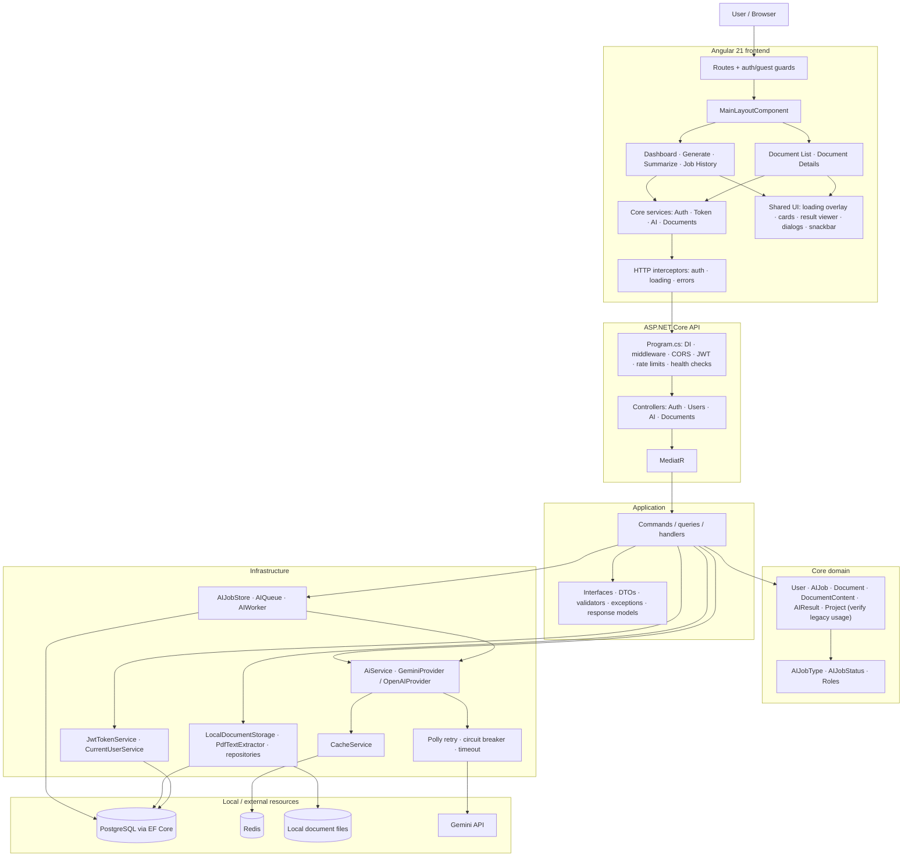
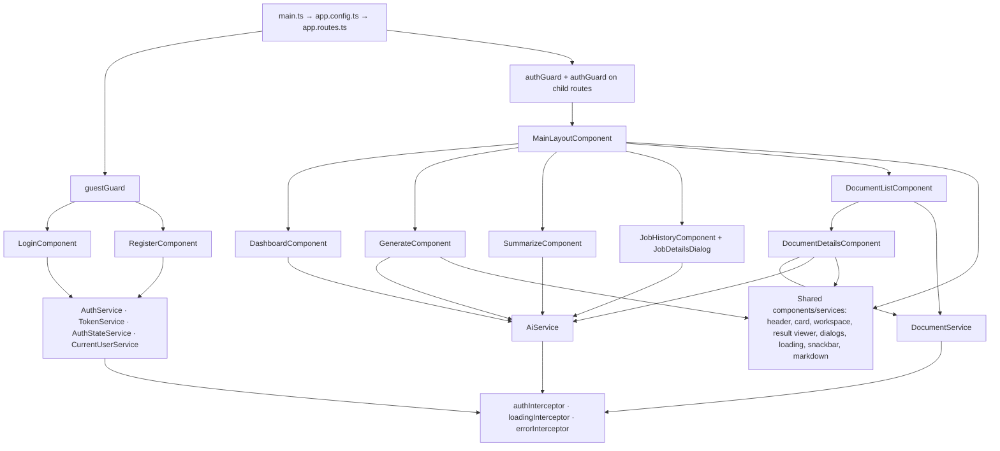
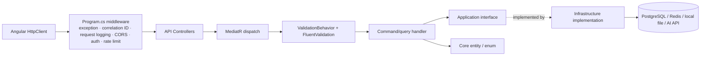
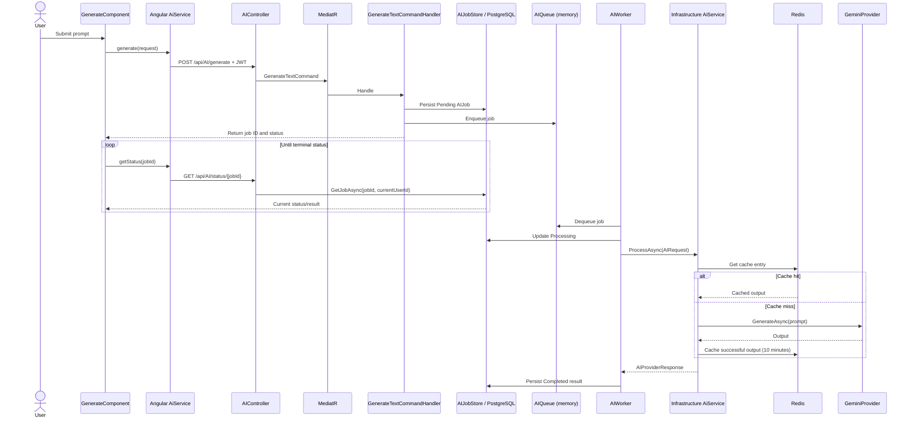
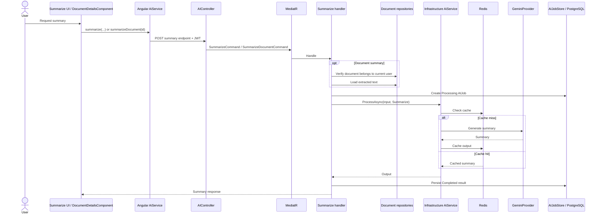
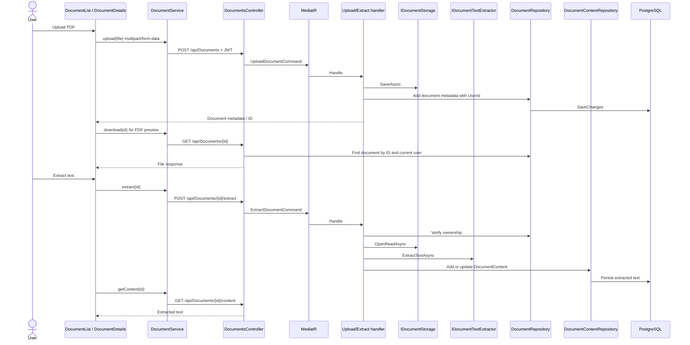
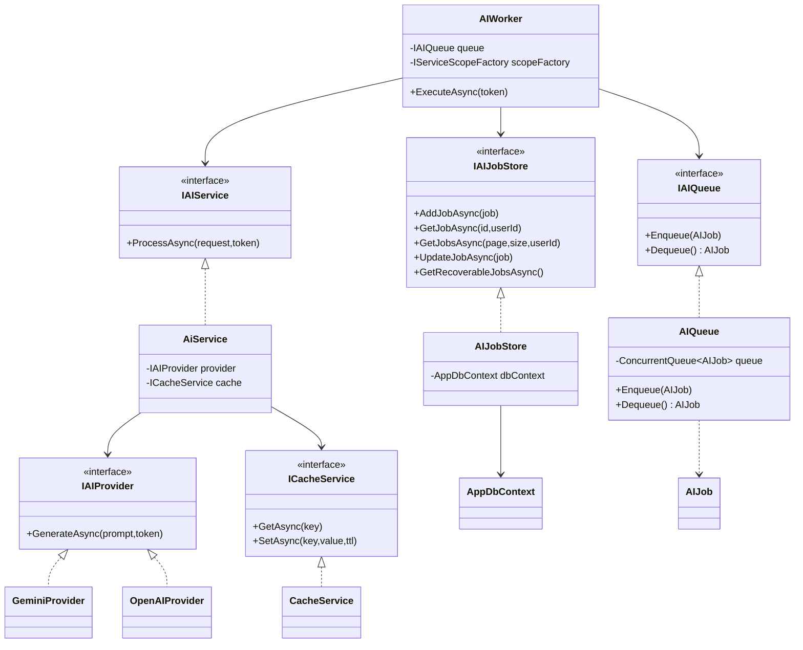
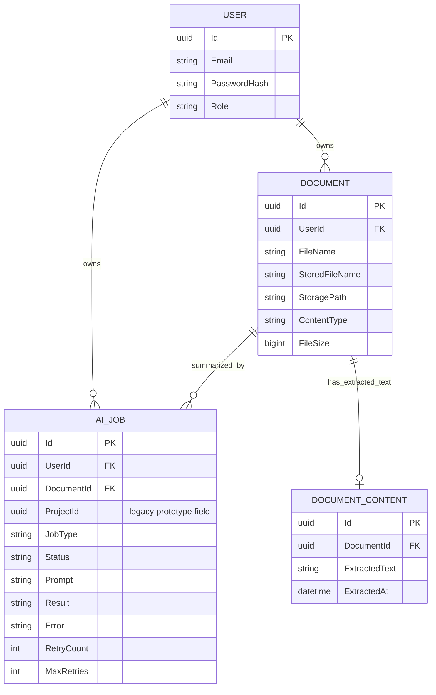

# Smart AI Dashboard — Architecture Blueprint

> **Living source of truth.** Start here before changing architecture, implementing a feature, or beginning cloud deployment. Update this document whenever implementation changes. Diagrams describe the repository at the baseline commit listed below; re-check source before treating them as current after code changes.

- Repository: [Aminafia/Smart-AI-Dashboard](https://github.com/Aminafia/Smart-AI-Dashboard)
- Baseline branch: `main`
- Baseline commit: `1ecdb51be7c74f9a78f664d61110bb45479a1f5e`
- Tracked files at baseline: **361**
- Purpose: map system boundaries, execution paths, dependencies, persistence, and code-file locations.
- Important limit: diagrams summarize and connect source files; they do not replace source code. The inventory at the end makes tracked files discoverable. Individual implementation details must be verified against each linked source file.

## 1. Locked-in product and architecture decisions

1. This is **one Smart AI Dashboard application** with a shared frontend and backend, not a collection of separately managed AI projects.
2. `ProjectId` in `AIJob` and the `Project` entity are legacy prototype concepts. Do not add project-management features to justify them. Trace references, then remove obsolete fields/entities with a safe EF Core migration after confirming no functional dependencies.
3. Text generation is asynchronous because it can take longer: persist job, enqueue, process in `AIWorker`, persist status/result, poll status.
4. Text and document summarization are currently synchronous: call the AI service in the request handler and return the result. This is intentional for current workloads.
5. Local queue/storage are acceptable for local development. Cloud evolution is planned, not a reason for premature redesign: local files → S3; in-memory queue → SQS; containerized API/worker; managed database/cache as selected during deployment design.
6. Finish code consistency and essential end-to-end verification before deployment. Keep the implementation simple; no Kubernetes, Kafka, or microservice split unless a demonstrated requirement justifies it.

## 2. Level 0 — Master system map

### Layer rules

- **Frontend:** route and view state; calls REST endpoints through typed services.
- **API:** HTTP boundary, middleware, auth configuration, routing, status codes and request/response serialization.
- **Application:** use-case orchestration through MediatR; depends on abstractions, not concrete storage/provider implementations.
- **Core:** domain entities and enums.
- **Infrastructure:** implementations of interfaces, EF Core, file storage, AI provider, Redis, resilience and worker.
- **External resources:** PostgreSQL, Redis and Gemini are separate runtime dependencies. Local files and in-memory queue are current local implementations.

## 3. Level 1 — Frontend route and service map

Routes defined in `frontend/src/app/app.routes.ts`:
- `/login`, `/register` — guest guarded.
- `/dashboard`, `/ai/generate`, `/summarize`, `/ai/jobs`, `/documents`, `/documents/:id` — authenticated layout.
- Unknown routes redirect to dashboard.

Key frontend source areas:
- App bootstrap/config: `frontend/src/main.ts`, `frontend/src/app/app.config.ts`, `frontend/src/app/app.routes.ts`.
- Core infrastructure: `frontend/src/app/core/guards/`, `core/interceptors/`, `core/services/`, `core/models/`.
- Features: `frontend/src/app/features/auth/`, `features/ai/`, `features/dashboard/`, `features/documents/`.
- Shared presentation: `frontend/src/app/shared/components/`, `frontend/src/app/shared/services/`.
- Environment/build: `frontend/src/environments/`, `frontend/angular.json`, `frontend/package.json`, `frontend/tsconfig*.json`, `frontend/styles.css`, `frontend/material-theme.scss`.

## 4. Level 1 — Backend dependency and request map

Registration and bootstrap:
- `backend/API/Program.cs`: web host, logging, controllers, JSON enum conversion, Swagger, application/infrastructure/auth/health-check registrations, CORS, Redis cache registration, rate limiting, middleware pipeline, controller mapping.
- `backend/Application/DependencyInjection.cs`: MediatR handlers, FluentValidation validators, validation pipeline behavior.
- `backend/Infrastructure/DependencyInjection.cs`: EF Core/Npgsql, repositories, current-user service, local document storage, PDF extractor, AI service/provider, JWT service, cache service, HttpClient resilience policies, singleton in-memory queue and hosted AI worker.
- `backend/Infrastructure/Data/AppDbContext.cs`: entity sets, enum-to-string conversions, indexes and one-to-one document-content relation.

### Controller endpoint map (verify contracts against current source)

| Controller | Route | Purpose |
|---|---|---|
| AuthController | `POST /api/auth/login` | Validate credentials and issue JWT |
| AuthController | `POST /api/auth/register` | Register account |
| UsersController | `GET /api/users` | Admin-only user listing |
| UsersController | `POST /api/users` | Admin-only user creation |
| AIController | `POST /api/AI/generate` | Create queued generation job |
| AIController | `GET /api/AI/status/{jobId}` | Retrieve current user's job status/result |
| AIController | `GET /api/AI/jobs` | Paginated current user's jobs |
| AIController | `POST /api/AI/summarize` | Synchronous plain-text summary |
| AIController | `POST /api/AI/documents/{documentId}/summarize` | Synchronous document summary |
| AIController | `GET /api/AI/stats` | Current user's job statistics |
| AIController | `GET /api/AI/documents/{documentId}/summary` | Retrieve saved completed document summary |
| DocumentsController | `POST /api/Documents` | Upload document |
| DocumentsController | `GET /api/Documents` | Paginated document list |
| DocumentsController | `GET /api/Documents/{id}` | Download/preview original file |
| DocumentsController | `DELETE /api/Documents/{id}` | Delete document |
| DocumentsController | `POST /api/Documents/{id}/extract` | Extract and persist text |
| DocumentsController | `GET /api/Documents/{id}/content` | Retrieve extracted text |

## 5. Sequence — asynchronous text generation

Failure branch: worker increments retry count, records the job state, waits with exponential delay and re-enqueues while retries remain; otherwise it persists Failed status/error. On startup, the worker queries recoverable jobs from PostgreSQL. Verify exact transitions in `backend/Infrastructure/BackgroundServices/AIWorker.cs`.

**Important:** the database is durable; the current `ConcurrentQueue<AIJob>` is not. PostgreSQL recovery is a mitigation, not a distributed durable queue or an exactly-once guarantee.

## 6. Sequence — synchronous summarization

This is intentionally synchronous for the current workload. The handler persists Completed or Failed state and returns the output directly. The Angular document-details component renders Markdown and separately reloads saved summaries on later visits.

## 7. Sequence — document upload, extraction and preview

Ownership invariant: handlers must verify document ownership before using document IDs to retrieve content, delete files, extract text or summarize content. Keep this check when adding endpoints.

Current implementation note: Document Details finds the metadata by loading page 1 of up to 100 documents. This is a known improvement, not a reason to block architecture documentation.

## 8. Class / dependency diagram — AI worker and provider boundary

The currently registered provider is `GeminiProvider`; `OpenAIProvider` exists but is not currently registered as automatic fallback in the inspected infrastructure registration. Do not assume failover occurs just because both implementations exist.

## 9. Domain and data ownership map

Treat the diagram as a logical ownership map. Confirm exact database foreign-key constraints and deletion behavior against every migration and the current model snapshot before making schema changes. `ProjectId` is not an active product requirement.

## 10. Reliability, cache and configuration

- **AI retry and circuit breaker:** `backend/Infrastructure/Resilience/AIResiliencePolicy.cs`, attached to named `AIClient` with an HTTP timeout in `Infrastructure/DependencyInjection.cs`. Inspect actual provider HTTP usage and policy behavior when validating retry semantics.
- **Cache:** `AiService` derives a cache key from job type and input, tolerates cache GET/SET exceptions, and caches successful outputs for ten minutes. Cache-key privacy/length and provider/model versioning are later hardening considerations, not a reason to add architecture now.
- **Logging:** Serilog console and rolling JSON file sinks in `backend/API/Program.cs`; correlation ID and request logging middleware are registered.
- **Health checks:** custom health-check registration and mapping in `backend/API/Extensions/HealthCheckExtensions.cs`.
- **Secrets/config:** inspect `backend/API/appsettings.json`, `appsettings.Development.json`, environment variables and JWT/provider settings. Never commit real credentials. Replace local configuration with managed secret injection in cloud.
- **Rate limiting:** concurrency and fixed-window policies configured in `Program.cs`; the AI generation endpoint has an explicit fixed-window attribute.
- **Database:** EF Core/Npgsql and migration history under `backend/Infrastructure/Migrations/`.
- **Current storage boundary:** `IDocumentStorage` / `LocalDocumentStorage` is the replacement point for future S3 implementation.
- **Current queue boundary:** `IAIQueue` / `AIQueue` is the replacement point for future SQS integration.

## 11. Stabilization and cloud sequence

1. Complete file-by-file dependency and endpoint mapping; confirm no unaccounted runtime path.
2. Remove obsolete project prototype fields/entities only after reference and migration checks.
3. Verify end-to-end login, generation/recovery, summarization, upload, extraction, preview, delete, history and ownership isolation.
4. Fix only confirmed correctness/security blockers and record non-blocking improvements.
5. Containerize the API and frontend/serving setup; separate API and worker runtime roles where appropriate.
6. Deploy the first working version to AWS with appropriate IAM, networking, secret management and logging.
7. Replace local document storage with S3 and in-memory queue with SQS at the planned integration stage; test retries, duplicates and recovery.
8. Add cloud monitoring, CI/CD and cost controls; expand into RAG/agents/multimodal capabilities only after the base system is stable.

## 12. Complete tracked-file inventory

This inventory is generated from the repository Git tree at the baseline commit above. Every tracked path appears under one category. It is a discovery index; the file itself remains the source of truth.

### Root / other (4 files)

- `.gitignore` — 292 bytes
- `README.md` — 24 bytes
- `backend/BackendSmartAIDashboard.sln` — 2,394 bytes
- `global.json` — 43 bytes

### Learning notes (49 files)

- `Notes/1. Overview.pdf` — 88,730 bytes
- `Notes/10. DAY 7 — JWT Authentication & Authorization.pdf` — 3,928,117 bytes
- `Notes/11. Day 8 — Authorization & Role-Based Access Control (RBAC).pdf` — 147,129 bytes
- `Notes/12. Day 9 — Role-Based Authorization.pdf` — 3,936,551 bytes
- `Notes/13. Day 10 — Global Exception Handling & API Response Standardization.pdf` — 159,911 bytes
- `Notes/14. Day 11-1 Architecture Enforcement.pdf` — 3,918,786 bytes
- `Notes/15. Day 11-2 Logging System.pdf` — 115,852 bytes
- `Notes/16. DAY 12 — Polly for External API Resilience.pdf` — 129,861 bytes
- `Notes/17. Day 13 - Rate limitting + Caching.pdf` — 138,521 bytes
- `Notes/18. Day 14 — Resilient AI Integration + Fault-Tolerant Caching.pdf` — 3,961,469 bytes
- `Notes/19. DAY 15 — ASYNCHRONOUS AI JOB PROCESSING.pdf` — 4,088,982 bytes
- `Notes/2. Daywise Roadmap.pdf` — 94,640 bytes
- `Notes/20. Backend Pipeline + Authentication Flow + Logging + Middleware Understanding.pdf` — 87,175 bytes
- `Notes/3. Day 1-1 Request Lifecycle.pdf` — 161,230 bytes
- `Notes/4. Day 1-2 Request Lifecycle.pdf` — 124,643 bytes
- `Notes/5. Day 2 Middleware Pipeline.pdf` — 4,054,920 bytes
- `Notes/6. Day 3 Dependency Injection Architecture.pdf` — 189,363 bytes
- `Notes/7. Day 4 CQRS & MediatR.pdf` — 166,148 bytes
- `Notes/8. Day 5 – Validation + Pipeline Behaviors (FluentValidation + MediatR).pdf` — 136,641 bytes
- `Notes/9. Day 6 — Database Integration (EF Core + PostgreSQL).pdf` — 137,533 bytes
- `Notes/Understanding Notes/1. Backend Architecture/Program.cs.md` — 19,744 bytes
- `Notes/Understanding Notes/1. Backend Architecture/a. Clean Architecture.md` — 1,069 bytes
- `Notes/Understanding Notes/1. Backend Architecture/b. Request Lifecycle.md` — 6,229 bytes
- `Notes/Understanding Notes/1. Backend Architecture/c. Middleware Pipeline.md` — 7,363 bytes
- `Notes/Understanding Notes/1. Backend Architecture/d. CQRS + MediatR.md` — 5,315 bytes
- `Notes/Understanding Notes/1. Backend Architecture/e. Dependency Injection.md` — 8,068 bytes
- `Notes/Understanding Notes/2. Security/a. JWT Authentication.md` — 8,203 bytes
- `Notes/Understanding Notes/2. Security/b. Authorization + Policies.md` — 5,477 bytes
- `Notes/Understanding Notes/2. Security/c. BCrypt + Password Hashing.md` — 5,740 bytes
- `Notes/Understanding Notes/3. Data Layer/a. Repository Pattern.md` — 7,029 bytes
- `Notes/Understanding Notes/3. Data Layer/b. EF Core Internals.md` — 7,117 bytes
- `Notes/Understanding Notes/3. Data Layer/c. DBContext Understanding.md` — 14,318 bytes
- `Notes/Understanding Notes/4. Observability/a. Logging + Serilog.md` — 7,297 bytes
- `Notes/Understanding Notes/4. Observability/b. Correlation IDs.md` — 6,020 bytes
- `Notes/Understanding Notes/4. Observability/c. Exception Handling.md` — 7,098 bytes
- `Notes/Understanding Notes/4. Observability/d. Health Checks.md` — 6,476 bytes
- `Notes/Understanding Notes/5. AI Infrastructure/a. AI Job Processing.md` — 7,376 bytes
- `Notes/Understanding Notes/5. AI Infrastructure/b. Background Workers.md` — 7,531 bytes
- `Notes/Understanding Notes/5. AI Infrastructure/c. Queue Architecture.md` — 8,258 bytes
- `Notes/Understanding Notes/5. AI Infrastructure/d. Retry Systems.md` — 7,179 bytes
- `Notes/Understanding Notes/6. Scalability + Resilience/a. Polly + Fault Tolerance.md` — 7,243 bytes
- `Notes/Understanding Notes/6. Scalability + Resilience/b. Rate Limitting.md` — 6,446 bytes
- `Notes/Understanding Notes/6. Scalability + Resilience/c. Redis Caching.md` — 7,565 bytes
- `Notes/Understanding Notes/AI Pipeline Documentation.md` — 7,881 bytes
- `Notes/Understanding Notes/Angular Architecture & Execution Flow..md` — 103,831 bytes
- `Notes/Understanding Notes/Angular Architecture & Execution Flow..pdf` — 1,881,859 bytes
- `Notes/Understanding Notes/Angular File Anatomy.md` — 40,459 bytes
- `Notes/Understanding Notes/Angular File Anatomy.pdf` — 740,898 bytes
- `Notes/Understanding Notes/Index.md` — 1,152 bytes

### Python AI engine (5 files)

- `ai-engine/app.py` — 780 bytes
- `ai-engine/inference.py` — 1,189 bytes
- `ai-engine/notebooks/summarizer_experiments.ipynb` — 567 bytes
- `ai-engine/requirements.txt` — 649 bytes
- `ai-engine/utils.py` — 251 bytes

### Backend / API (24 files)

- `backend/API/API.csproj` — 1,849 bytes
- `backend/API/API.http` — 113 bytes
- `backend/API/Controllers/AIController.cs` — 3,887 bytes
- `backend/API/Controllers/AuthController.cs` — 3,276 bytes
- `backend/API/Controllers/DocumentsController.cs` — 3,649 bytes
- `backend/API/Controllers/TestController.cs` — 1,226 bytes
- `backend/API/Controllers/UsersController.cs` — 1,455 bytes
- `backend/API/Extensions/AuthExtensions.cs` — 2,464 bytes
- `backend/API/Extensions/HealthCheckExtensions.cs` — 1,715 bytes
- `backend/API/Middlewares/CorrelationIdMiddleware.cs` — 2,675 bytes
- `backend/API/Middlewares/ExceptionHandlingMiddleware.cs` — 6,516 bytes
- `backend/API/Middlewares/RequestLoggingMiddleware.cs` — 2,579 bytes
- `backend/API/Program.cs` — 3,470 bytes
- `backend/API/Properties/launchSettings.json` — 1,082 bytes
- `backend/API/Storage/Documents/00679b99-f646-4f8c-a794-b728366c8dfe.pdf` — 255,172 bytes
- `backend/API/Storage/Documents/345c0569-4ac5-44db-bec1-19bba04357bc.pdf` — 48,960 bytes
- `backend/API/Storage/Documents/36e9eaef-7375-4f39-b416-699b1c99641e.pdf` — 330,645 bytes
- `backend/API/Storage/Documents/53054b22-5a6f-44c1-842b-b07a9a4d1024.pdf` — 232,838 bytes
- `backend/API/Storage/Documents/7015e7e3-ce39-4302-8b58-85a1298c90ca.pdf` — 47,872 bytes
- `backend/API/Storage/Documents/7c53e1c5-eaf8-435f-a8ba-4f29b91b2795.pdf` — 323,388 bytes
- `backend/API/Storage/Documents/89c0f221-3363-4549-87c7-7510d8b3dc2a.txt` — 1,742 bytes
- `backend/API/Storage/Documents/d7227c07-0bbe-469c-a05a-e3acdbafbc48.pdf` — 218,254 bytes
- `backend/API/appsettings.Development.json` — 503 bytes
- `backend/API/appsettings.json` — 485 bytes

### Backend / Application (82 files)

- `backend/Application/Application.csproj` — 713 bytes
- `backend/Application/Application.sln` — 1,092 bytes
- `backend/Application/Common/Behaviors/ValidationBehavior.cs` — 1,533 bytes
- `backend/Application/Common/Exceptions/BadRequestException.cs` — 157 bytes
- `backend/Application/Common/Exceptions/DuplicateEmailException.cs` — 208 bytes
- `backend/Application/Common/Exceptions/NotFoundException.cs` — 153 bytes
- `backend/Application/Common/Exceptions/UnauthorizedException.cs` — 161 bytes
- `backend/Application/Common/Models/ApiResponse.cs` — 2,465 bytes
- `backend/Application/Common/Models/PagedResponse.cs` — 429 bytes
- `backend/Application/Common/Prompts/PromptBuilder.cs` — 207 bytes
- `backend/Application/Common/Prompts/PromptTemplate.cs` — 304 bytes
- `backend/Application/DTOs/AI/AIOperationResponse.cs` — 461 bytes
- `backend/Application/DTOs/AI/AIProviderResponse.cs` — 329 bytes
- `backend/Application/DTOs/AI/AIRequest.cs` — 404 bytes
- `backend/Application/DTOs/AI/GenerateTextRequest.cs` — 123 bytes
- `backend/Application/DTOs/AI/SummarizeRequest.cs` — 136 bytes
- `backend/Application/DTOs/Auth/AuthResponse.cs` — 111 bytes
- `backend/Application/DTOs/Auth/LoginRequest.cs` — 161 bytes
- `backend/Application/DTOs/Documents/DocumentUpload.cs` — 244 bytes
- `backend/Application/DependencyInjection.cs` — 705 bytes
- `backend/Application/Features/AI/AIRequestValidator.cs` — 578 bytes
- `backend/Application/Features/AI/Commands/GenerateText/GenerateTextCommand.cs` — 436 bytes
- `backend/Application/Features/AI/Commands/GenerateText/GenerateTextCommandHandler.cs` — 1,309 bytes
- `backend/Application/Features/AI/Commands/Summarize/SummarizeCommand.cs` — 218 bytes
- `backend/Application/Features/AI/Commands/Summarize/SummarizeCommandHandler.cs` — 1,705 bytes
- `backend/Application/Features/AI/Commands/Summarize/SummarizeCommandValidator.cs` — 381 bytes
- `backend/Application/Features/AI/Commands/SummarizeDocument/SummarizeDocumentCommand.cs` — 221 bytes
- `backend/Application/Features/AI/Commands/SummarizeDocument/SummarizeDocumentCommandHandler.cs` — 2,723 bytes
- `backend/Application/Features/AI/Queries/GetAIJobs/GetAIJobsQuery.cs` — 267 bytes
- `backend/Application/Features/AI/Queries/GetAIJobs/GetAIJobsQueryHandler.cs` — 1,211 bytes
- `backend/Application/Features/AI/Queries/GetAIJobs/GetAIJobsResponse.cs` — 391 bytes
- `backend/Application/Features/AI/Queries/GetAIStats/AIStatsResponse.cs` — 256 bytes
- `backend/Application/Features/AI/Queries/GetAIStats/GetAIStatsQuery.cs` — 131 bytes
- `backend/Application/Features/AI/Queries/GetAIStats/GetAIStatsQueryHandler.cs` — 703 bytes
- `backend/Application/Features/AI/Queries/GetAIStatus/AIStatusResponse.cs` — 473 bytes
- `backend/Application/Features/AI/Queries/GetAIStatus/GetAIStatusQuery.cs` — 169 bytes
- `backend/Application/Features/AI/Queries/GetAIStatus/GetAIStatusQueryHandler.cs` — 1,058 bytes
- `backend/Application/Features/AI/Queries/GetDocumentSummary/DocumentSummaryResponse.cs` — 234 bytes
- `backend/Application/Features/AI/Queries/GetDocumentSummary/GetDocumentSummaryQuery.cs` — 196 bytes
- `backend/Application/Features/AI/Queries/GetDocumentSummary/GetDocumentSummaryQueryHandler.cs` — 1,180 bytes
- `backend/Application/Features/Auth/Commands/Login/LoginCommand.cs` — 444 bytes
- `backend/Application/Features/Auth/Commands/Login/LoginCommandHandler.cs` — 2,632 bytes
- `backend/Application/Features/Auth/Commands/Login/LoginCommandValidator.cs` — 528 bytes
- `backend/Application/Features/Auth/Commands/Login/LoginResponse.cs` — 191 bytes
- `backend/Application/Features/Documents/Commands/DeleteDocument/DeleteDocumentCommandHandler.cs` — 1,168 bytes
- `backend/Application/Features/Documents/Commands/ExtractDocument/ExtractDocumentCommand.cs` — 175 bytes
- `backend/Application/Features/Documents/Commands/ExtractDocument/ExtractDocumentCommandHandler.cs` — 2,324 bytes
- `backend/Application/Features/Documents/Commands/UploadDocument/DeleteDocument/DeleteDocumentCommand.cs` — 165 bytes
- `backend/Application/Features/Documents/Commands/UploadDocument/UploadDocumentCommand.cs` — 287 bytes
- `backend/Application/Features/Documents/Commands/UploadDocument/UploadDocumentCommandHandler.cs` — 1,819 bytes
- `backend/Application/Features/Documents/Commands/UploadDocument/UploadDocumentCommandValidator.cs` — 2,250 bytes
- `backend/Application/Features/Documents/Models/DocumentContentResponse.cs` — 241 bytes
- `backend/Application/Features/Documents/Models/DocumentResponse.cs` — 321 bytes
- `backend/Application/Features/Documents/Queries/GetDocuments/GetDocument/GetDocumentQuery.cs` — 175 bytes
- `backend/Application/Features/Documents/Queries/GetDocuments/GetDocument/GetDocumentQueryHandler.cs` — 1,246 bytes
- `backend/Application/Features/Documents/Queries/GetDocuments/GetDocument/GetDocumentResult.cs` — 285 bytes
- `backend/Application/Features/Documents/Queries/GetDocuments/GetDocumentContent/GetDocumentContentQuery.cs` — 252 bytes
- `backend/Application/Features/Documents/Queries/GetDocuments/GetDocumentContent/GetDocumentContentQueryHandler.cs` — 1,560 bytes
- `backend/Application/Features/Documents/Queries/GetDocuments/GetDocumentsQuery.cs` — 324 bytes
- `backend/Application/Features/Documents/Queries/GetDocuments/GetDocumentsQueryHandler.cs` — 1,348 bytes
- `backend/Application/Features/Users/Commands/CreateUser/CreateUserCommand.cs` — 183 bytes
- `backend/Application/Features/Users/Commands/CreateUser/CreateUserCommandHandler.cs` — 1,408 bytes
- `backend/Application/Features/Users/Commands/CreateUser/CreateUserCommandValidator.cs` — 615 bytes
- `backend/Application/Features/Users/DTOs/UserDto.cs` — 253 bytes
- `backend/Application/Features/Users/Queries/GetUsers/GetUsersQuery.cs` — 166 bytes
- `backend/Application/Features/Users/Queries/GetUsers/GetUsersQueryHandler.cs` — 821 bytes
- `backend/Application/Interfaces/IAIJobStore.cs` — 558 bytes
- `backend/Application/Interfaces/IAIProvider.cs` — 301 bytes
- `backend/Application/Interfaces/IAIQueue.cs` — 137 bytes
- `backend/Application/Interfaces/IAIService.cs` — 514 bytes
- `backend/Application/Interfaces/ICacheService.cs` — 171 bytes
- `backend/Application/Interfaces/ICurrentUserService.cs` — 100 bytes
- `backend/Application/Interfaces/IDocumentContentRepository.cs` — 372 bytes
- `backend/Application/Interfaces/IDocumentRepository.cs` — 509 bytes
- `backend/Application/Interfaces/IDocumentStorage.cs` — 365 bytes
- `backend/Application/Interfaces/IDocumentTextExtractor.cs` — 186 bytes
- `backend/Application/Interfaces/IEmbeddingProvider.cs` — 129 bytes
- `backend/Application/Interfaces/IJwtTokenService.cs` — 245 bytes
- `backend/Application/Interfaces/ILLMProvider.cs` — 169 bytes
- `backend/Application/Interfaces/IUserRepository.cs` — 414 bytes
- `backend/Application/Interfaces/IVectorSearchProvider.cs` — 153 bytes
- `backend/Application/Validation/Common/PaginationValidator.cs`

### Backend / Core domain (10 files)

- `backend/Core/Constants/Roles.cs` — 137 bytes
- `backend/Core/Core.csproj` — 209 bytes
- `backend/Core/Entities/AIJob.cs` — 688 bytes
- `backend/Core/Entities/AIResult.cs` — 315 bytes
- `backend/Core/Entities/Document.cs` — 471 bytes
- `backend/Core/Entities/DocumentContent.cs` — 315 bytes
- `backend/Core/Entities/Project.cs` — 312 bytes
- `backend/Core/Entities/User.cs` — 349 bytes
- `backend/Core/Enums/AIJobStatus.cs` — 119 bytes
- `backend/Core/Enums/AIJobType.cs` — 121 bytes

### Backend / Infrastructure (41 files)

- `backend/Infrastructure/AI/AiService.cs` — 3,079 bytes
- `backend/Infrastructure/AI/Models/GeminiRequest.cs` — 301 bytes
- `backend/Infrastructure/AI/Models/GeminiResponse.cs` — 391 bytes
- `backend/Infrastructure/AI/Providers/GeminiProvider.cs` — 3,255 bytes
- `backend/Infrastructure/AI/Providers/OpenAIProvider.cs` — 1,469 bytes
- `backend/Infrastructure/Auth/JwtSettings.cs` — 505 bytes
- `backend/Infrastructure/Auth/JwtTokenService.cs` — 2,521 bytes
- `backend/Infrastructure/BackgroundServices/AIWorker.cs` — 6,292 bytes
- `backend/Infrastructure/Data/AppDbContext.cs` — 1,085 bytes
- `backend/Infrastructure/DependencyInjection.cs` — 2,055 bytes
- `backend/Infrastructure/DocumentProcessing/PdfTextExtractor.cs` — 911 bytes
- `backend/Infrastructure/Infrastructure.csproj` — 1,583 bytes
- `backend/Infrastructure/Migrations/20260329153931_InitialCreate.Designer.cs` — 1,921 bytes
- `backend/Infrastructure/Migrations/20260329153931_InitialCreate.cs` — 1,320 bytes
- `backend/Infrastructure/Migrations/20260615205219_AddAIJobs.Designer.cs` — 3,385 bytes
- `backend/Infrastructure/Migrations/20260615205219_AddAIJobs.cs` — 1,757 bytes
- `backend/Infrastructure/Migrations/20260617090749_ConvertJobTypeToEnum.Designer.cs` — 3,407 bytes
- `backend/Infrastructure/Migrations/20260617090749_ConvertJobTypeToEnum.cs` — 443 bytes
- `backend/Infrastructure/Migrations/20260720182021_ConvertStatusToEnum.Designer.cs` — 3,405 bytes
- `backend/Infrastructure/Migrations/20260720182021_ConvertStatusToEnum.cs` — 442 bytes
- `backend/Infrastructure/Migrations/20260724203456_AddDocuments.Designer.cs` — 4,501 bytes
- `backend/Infrastructure/Migrations/20260724203456_AddDocuments.cs` — 1,431 bytes
- `backend/Infrastructure/Migrations/20260822162717_AddDocumentContent.Designer.cs` — 5,741 bytes
- `backend/Infrastructure/Migrations/20260822162717_AddDocumentContent.cs` — 1,736 bytes
- `backend/Infrastructure/Migrations/20260828210000_AddOwnership.Designer.cs` — 78 bytes
- `backend/Infrastructure/Migrations/20260828212727_AddOwnership.Designer.cs` — 6,121 bytes
- `backend/Infrastructure/Migrations/20260828212727_AddOwnership.cs` — 3,076 bytes
- `backend/Infrastructure/Migrations/AppDbContextModelSnapshot.cs` — 6,022 bytes
- `backend/Infrastructure/Migrations/OWNERSHIP_MIGRATION_REGENERATION.md` — 191 bytes
- `backend/Infrastructure/Migrations/README.md` — 25 bytes
- `backend/Infrastructure/Migrations/TEMP.txt` — 1 bytes
- `backend/Infrastructure/Migrations/cleanup-note.md` — 89 bytes
- `backend/Infrastructure/Repositories/DocumentContentRepository.cs` — 1,170 bytes
- `backend/Infrastructure/Repositories/DocumentRepository.cs` — 1,756 bytes
- `backend/Infrastructure/Repositories/UserRepository.cs` — 4,407 bytes
- `backend/Infrastructure/Resilience/AIResiliencePolicy.cs` — 852 bytes
- `backend/Infrastructure/Services/AIJobStore.cs` — 2,936 bytes
- `backend/Infrastructure/Services/AIQueue.cs` — 548 bytes
- `backend/Infrastructure/Services/CacheService.cs` — 682 bytes
- `backend/Infrastructure/Services/CurrentUserService.cs` — 789 bytes
- `backend/Infrastructure/Storage/LocalDocumentStorage.cs` — 1,571 bytes

### Project documentation (1 files)

- `docs/IMPLEMENTATION_SPRINT.md` — 517 bytes

### Angular frontend (145 files)

- `frontend/.editorconfig` — 314 bytes
- `frontend/.gitignore` — 604 bytes
- `frontend/.postcssrc.json` — 53 bytes
- `frontend/.vscode/extensions.json` — 130 bytes
- `frontend/.vscode/launch.json` — 470 bytes
- `frontend/.vscode/settings.json` — 58 bytes
- `frontend/.vscode/tasks.json` — 978 bytes
- `frontend/README.md` — 1,461 bytes
- `frontend/angular.json` — 2,192 bytes
- `frontend/package-lock.json` — 316,356 bytes
- `frontend/package.json` — 1,281 bytes
- `frontend/public/favicon.ico` — 15,086 bytes
- `frontend/src/app/app.component.css`
- `frontend/src/app/app.component.html` — 76 bytes
- `frontend/src/app/app.component.spec.ts` — 721 bytes
- `frontend/src/app/app.component.ts` — 414 bytes
- `frontend/src/app/app.config.ts` — 936 bytes
- `frontend/src/app/app.routes.ts` — 1,788 bytes
- `frontend/src/app/core/constants/jwt-claims.ts` — 168 bytes
- `frontend/src/app/core/constants/loading-context.ts` — 129 bytes
- `frontend/src/app/core/guards/auth.guard.spec.ts` — 461 bytes
- `frontend/src/app/core/guards/auth.guard.ts` — 392 bytes
- `frontend/src/app/core/guards/guest.guard.spec.ts`
- `frontend/src/app/core/guards/guest.guard.ts` — 398 bytes
- `frontend/src/app/core/interceptors/auth.interceptor.spec.ts` — 476 bytes
- `frontend/src/app/core/interceptors/auth.interceptor.ts` — 499 bytes
- `frontend/src/app/core/interceptors/error.interceptor.spec.ts` — 480 bytes
- `frontend/src/app/core/interceptors/error.interceptor.ts` — 1,870 bytes
- `frontend/src/app/core/interceptors/loading.interceptor.spec.ts` — 488 bytes
- `frontend/src/app/core/interceptors/loading.interceptor.ts` — 546 bytes
- `frontend/src/app/core/models/ai/ai-job-status.model.ts` — 151 bytes
- `frontend/src/app/core/models/ai/ai-job.model.ts` — 205 bytes
- `frontend/src/app/core/models/ai/ai-stats.model.ts` — 122 bytes
- `frontend/src/app/core/models/ai/document-summary-response.model.ts` — 122 bytes
- `frontend/src/app/core/models/ai/generate-request.model.ts` — 54 bytes
- `frontend/src/app/core/models/ai/generate-response.model.ts` — 131 bytes
- `frontend/src/app/core/models/ai/job-status-response.model.ts` — 266 bytes
- `frontend/src/app/core/models/ai/summarize-request.model.ts` — 53 bytes
- `frontend/src/app/core/models/ai/summarize-response.model.ts` — 79 bytes
- `frontend/src/app/core/models/auth/current-user.ts` — 139 bytes
- `frontend/src/app/core/models/auth/jwt-payload.ts` — 278 bytes
- `frontend/src/app/core/models/auth/login-request.ts` — 70 bytes
- `frontend/src/app/core/models/auth/login-response.ts` — 68 bytes
- `frontend/src/app/core/models/auth/register-request.ts` — 89 bytes
- `frontend/src/app/core/models/documents/document-content-response.model.ts` — 114 bytes
- `frontend/src/app/core/models/documents/document-upload.model.ts` — 51 bytes
- `frontend/src/app/core/models/documents/document.model.ts` — 133 bytes
- `frontend/src/app/core/models/documents/upload-document-response.model.ts` — 77 bytes
- `frontend/src/app/core/models/jwt-payload.ts` — 204 bytes
- `frontend/src/app/core/models/shared/api-response.ts` — 112 bytes
- `frontend/src/app/core/models/shared/confirmation-dialog-data.ts` — 126 bytes
- `frontend/src/app/core/models/shared/paged-response.model.ts` — 183 bytes
- `frontend/src/app/core/services/ai.service.spec.ts` — 337 bytes
- `frontend/src/app/core/services/ai.service.ts` — 2,697 bytes
- `frontend/src/app/core/services/auth-state.service.spec.ts` — 373 bytes
- `frontend/src/app/core/services/auth-state.service.ts` — 632 bytes
- `frontend/src/app/core/services/auth.service.ts` — 1,380 bytes
- `frontend/src/app/core/services/current-user.service.ts` — 1,376 bytes
- `frontend/src/app/core/services/document.service.spec.ts` — 353 bytes
- `frontend/src/app/core/services/document.service.ts` — 2,125 bytes
- `frontend/src/app/core/services/loading.service.spec.ts` — 362 bytes
- `frontend/src/app/core/services/loading.service.ts` — 554 bytes
- `frontend/src/app/core/services/token.service.spec.ts` — 352 bytes
- `frontend/src/app/core/services/token.service.ts` — 519 bytes
- `frontend/src/app/features/ai/generate/generate.component.css` — 849 bytes
- `frontend/src/app/features/ai/generate/generate.component.html` — 1,141 bytes
- `frontend/src/app/features/ai/generate/generate.component.spec.ts` — 600 bytes
- `frontend/src/app/features/ai/generate/generate.component.ts` — 5,673 bytes
- `frontend/src/app/features/ai/job-details-dialog/job-details-dialog.component.css` — 1,371 bytes
- `frontend/src/app/features/ai/job-details-dialog/job-details-dialog.component.html` — 1,906 bytes
- `frontend/src/app/features/ai/job-details-dialog/job-details-dialog.component.spec.ts` — 658 bytes
- `frontend/src/app/features/ai/job-details-dialog/job-details-dialog.component.ts` — 1,746 bytes
- `frontend/src/app/features/ai/job-history/job-history.component.css` — 1,102 bytes
- `frontend/src/app/features/ai/job-history/job-history.component.html` — 3,016 bytes
- `frontend/src/app/features/ai/job-history/job-history.component.spec.ts` — 560 bytes
- `frontend/src/app/features/ai/job-history/job-history.component.ts` — 3,938 bytes
- `frontend/src/app/features/ai/summarize/summarize.component.css` — 849 bytes
- `frontend/src/app/features/ai/summarize/summarize.component.html` — 1,052 bytes
- `frontend/src/app/features/ai/summarize/summarize.component.spec.ts` — 618 bytes
- `frontend/src/app/features/ai/summarize/summarize.component.ts` — 2,332 bytes
- `frontend/src/app/features/auth/login/login.component.css` — 7,376 bytes
- `frontend/src/app/features/auth/login/login.component.html` — 3,953 bytes
- `frontend/src/app/features/auth/login/login.component.spec.ts` — 579 bytes
- `frontend/src/app/features/auth/login/login.component.ts` — 2,138 bytes
- `frontend/src/app/features/auth/register/register.component.css` — 8,593 bytes
- `frontend/src/app/features/auth/register/register.component.html` — 4,941 bytes
- `frontend/src/app/features/auth/register/register.component.spec.ts` — 610 bytes
- `frontend/src/app/features/auth/register/register.component.ts` — 2,261 bytes
- `frontend/src/app/features/dashboard/dashboard.component.css` — 1,275 bytes
- `frontend/src/app/features/dashboard/dashboard.component.html` — 1,946 bytes
- `frontend/src/app/features/dashboard/dashboard.component.spec.ts` — 607 bytes
- `frontend/src/app/features/dashboard/dashboard.component.ts` — 1,225 bytes
- `frontend/src/app/features/documents/pages/document-details/document-details.component.css` — 6,098 bytes
- `frontend/src/app/features/documents/pages/document-details/document-details.component.html` — 6,615 bytes
- `frontend/src/app/features/documents/pages/document-details/document-details.component.spec.ts` — 605 bytes
- `frontend/src/app/features/documents/pages/document-details/document-details.component.ts` — 13,415 bytes
- `frontend/src/app/features/documents/pages/document-list/document-list.component.css`
- `frontend/src/app/features/documents/pages/document-list/document-list.component.html` — 2,919 bytes
- `frontend/src/app/features/documents/pages/document-list/document-list.component.spec.ts` — 629 bytes
- `frontend/src/app/features/documents/pages/document-list/document-list.component.ts` — 4,932 bytes
- `frontend/src/app/layouts/main-layout/main-layout.component.css` — 4,164 bytes
- `frontend/src/app/layouts/main-layout/main-layout.component.html` — 2,678 bytes
- `frontend/src/app/layouts/main-layout/main-layout.component.spec.ts` — 615 bytes
- `frontend/src/app/layouts/main-layout/main-layout.component.ts` — 1,754 bytes
- `frontend/src/app/shared/components/confirmation-dialog/confirmation-dialog.component.css` — 331 bytes
- `frontend/src/app/shared/components/confirmation-dialog/confirmation-dialog.component.html` — 497 bytes
- `frontend/src/app/shared/components/confirmation-dialog/confirmation-dialog.component.spec.ts` — 680 bytes
- `frontend/src/app/shared/components/confirmation-dialog/confirmation-dialog.component.ts` — 990 bytes
- `frontend/src/app/shared/components/empty-state/empty-state.component.css` — 307 bytes
- `frontend/src/app/shared/components/empty-state/empty-state.component.html` — 527 bytes
- `frontend/src/app/shared/components/empty-state/empty-state.component.spec.ts` — 624 bytes
- `frontend/src/app/shared/components/empty-state/empty-state.component.ts` — 715 bytes
- `frontend/src/app/shared/components/loading-overlay/loading-overlay.component.css` — 359 bytes
- `frontend/src/app/shared/components/loading-overlay/loading-overlay.component.html` — 126 bytes
- `frontend/src/app/shared/components/loading-overlay/loading-overlay.component.spec.ts` — 652 bytes
- `frontend/src/app/shared/components/loading-overlay/loading-overlay.component.ts` — 586 bytes
- `frontend/src/app/shared/components/page-card/page-card.component.css` — 385 bytes
- `frontend/src/app/shared/components/page-card/page-card.component.html` — 113 bytes
- `frontend/src/app/shared/components/page-card/page-card.component.spec.ts` — 610 bytes
- `frontend/src/app/shared/components/page-card/page-card.component.ts` — 388 bytes
- `frontend/src/app/shared/components/page-header/page-header.component.css` — 1,099 bytes
- `frontend/src/app/shared/components/page-header/page-header.component.html` — 236 bytes
- `frontend/src/app/shared/components/page-header/page-header.component.spec.ts` — 624 bytes
- `frontend/src/app/shared/components/page-header/page-header.component.ts` — 396 bytes
- `frontend/src/app/shared/components/result-viewer/result-viewer.component.css` — 274 bytes
- `frontend/src/app/shared/components/result-viewer/result-viewer.component.html` — 514 bytes
- `frontend/src/app/shared/components/result-viewer/result-viewer.component.spec.ts` — 574 bytes
- `frontend/src/app/shared/components/result-viewer/result-viewer.component.ts` — 678 bytes
- `frontend/src/app/shared/components/workspace-section/workspace-section.component.css` — 179 bytes
- `frontend/src/app/shared/components/workspace-section/workspace-section.component.html` — 269 bytes
- `frontend/src/app/shared/components/workspace-section/workspace-section.component.spec.ts` — 666 bytes
- `frontend/src/app/shared/components/workspace-section/workspace-section.component.ts` — 606 bytes
- `frontend/src/app/shared/services/markdown.service.spec.ts` — 318 bytes
- `frontend/src/app/shared/services/markdown.service.ts` — 318 bytes
- `frontend/src/app/shared/services/snackbar.service.spec.ts` — 368 bytes
- `frontend/src/app/shared/services/snackbar.service.ts` — 1,335 bytes
- `frontend/src/environments/environment.prod.ts` — 89 bytes
- `frontend/src/environments/environment.ts` — 90 bytes
- `frontend/src/index.html` — 629 bytes
- `frontend/src/main.ts` — 250 bytes
- `frontend/src/material-theme.scss` — 423 bytes
- `frontend/src/styles.css` — 1,200 bytes
- `frontend/tsconfig.app.json` — 451 bytes
- `frontend/tsconfig.json` — 957 bytes
- `frontend/tsconfig.spec.json` — 466 bytes

## 13. Change-control rule for this blueprint

For every implementation change:
1. Identify the affected files in the inventory.
2. Update the relevant sequence/class/dependency diagram and endpoint/data contracts.
3. Record decisions, migration implications and tests.
4. Re-check the baseline SHA and update the document's baseline after the corresponding code change lands.
5. Do not mark a subsystem fully verified until its relevant source paths and tests have been inspected and executed.

---
*Generated for the current repository baseline. This is a living architecture document, not a claim that every feature has already passed runtime tests.*
