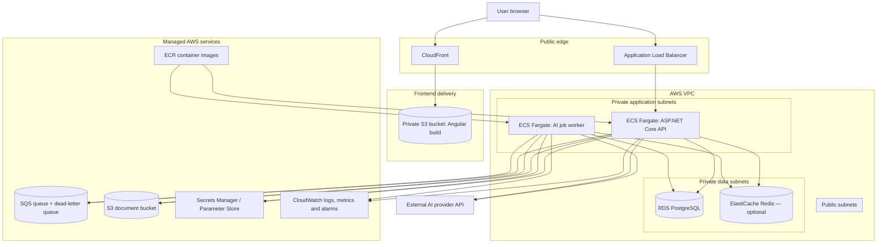

# Smart AI Dashboard — AWS Deployment Blueprint

> **Status:** Proposed target architecture and learning sequence. This is not a record of deployed infrastructure. Keep it separate from the current-state architecture until each AWS component is implemented and verified.

## 1. Goal

Deploy the existing Smart AI Dashboard incrementally while learning AWS through the project. Preserve the current product architecture: Angular frontend, ASP.NET Core API, Clean Architecture application layer, PostgreSQL persistence, Redis caching, AI provider integration, background AI jobs and document workflows.

Do not introduce Kubernetes, Kafka, microservices or additional managed services without a demonstrated need.

## 2. Current implementation → AWS evolution

| Current local component | AWS direction | Migration note |
|---|---|---|
| Angular 21 frontend | Amazon S3 static hosting + CloudFront | Build Angular for production; keep the bucket private and serve through CloudFront Origin Access Control |
| ASP.NET Core API | Container on Amazon ECS with AWS Fargate | Build a production Docker image, publish to ECR, run behind an Application Load Balancer |
| Hosted AIWorker / in-memory queue | Amazon SQS + worker consumer | Replace process-local queue semantics with durable messages; design idempotency, visibility timeout, retries and a dead-letter queue |
| PostgreSQL | Amazon RDS for PostgreSQL | Private subnets, security-group-only access, backups and migration plan |
| Local document storage | Amazon S3 | Use generated object keys, user/document authorization, least-privilege IAM and lifecycle policy |
| Redis | Amazon ElastiCache for Redis, if still justified | Add after measuring cache need and cost; cache is not the source of truth |
| Local configuration / secrets | AWS Secrets Manager or Systems Manager Parameter Store | No secrets in source, images, frontend bundles or logs |
| Serilog / local logs | Amazon CloudWatch Logs and metrics | Structured logs, correlation IDs, retention and alarms |
| Local Docker images | Amazon ECR | Image scanning, immutable tags and controlled deployment |
| GitHub Actions | GitHub Actions + AWS OIDC role | Avoid long-lived AWS access keys in GitHub secrets |

## 3. Proposed target architecture

The diagram represents the intended direction. It does not imply that any AWS resource already exists.

### Network and trust boundaries

- CloudFront is the public entry point for the Angular application; the frontend bucket should not be publicly writable or directly exposed.
- The Application Load Balancer is public; ECS tasks and data stores should not need public IP addresses.
- RDS and ElastiCache should accept traffic only from the relevant application security groups.
- ECS task roles should grant only the required S3, SQS, logging and secret-read permissions.
- The browser must never receive database credentials, AWS secret values or privileged AWS credentials.
- External AI provider access must use server-side secrets and outbound network access from the application environment.

## 4. Important design decisions to validate before implementation

1. **Compute choice:** ECS Fargate is the proposed learning/deployment target because it supports the API and background worker containers without managing EC2 hosts. Compare its baseline cost with simpler options before provisioning.
2. **Worker boundary:** the current AIWorker is registered as a hosted service in the API host. Decide whether to run the same image with a worker-specific mode initially or create a dedicated worker host. Do not accidentally run duplicate consumers without understanding scaling and message semantics.
3. **Queue semantics:** SQS is at-least-once delivery. A message may be delivered more than once. Add idempotent job processing, visibility-timeout handling, bounded retries and a dead-letter queue; do not promise exactly-once AI execution.
4. **Document consistency:** upload the object and persist metadata with explicit compensation/orphan-reconciliation behavior. Database and S3 operations do not share one transaction.
5. **Database migration:** use a reviewed migration against a disposable or staging RDS database before production data is involved.
6. **Redis:** defer ElastiCache until the app's cache requirement justifies its ongoing cost. The application must remain correct if cache entries disappear.
7. **AI provider networking and cost:** provider API calls incur separate usage costs and require controlled timeouts, retries and secret handling.

## 5. Incremental hands-on learning and delivery gates

### Gate 0 — AWS account safety

- Confirm account ownership and enable MFA on the root user.
- Do not create access keys for the root user.
- Configure an AWS Budget and billing alerts before provisioning resources.
- Create an IAM administrative identity for daily work and use least privilege for deployment roles.
- Choose a deployment region based on latency, service availability, data residency and cost; do not assume a region before checking current pricing and service support.

**Exit:** account access is secured and billing visibility is configured.

### Gate 1 — Containerize locally

- Create and verify production Docker builds for the Angular frontend and .NET API.
- Externalize all environment-specific settings.
- Verify health endpoints, non-root container execution where practical, graceful shutdown and persistent document-storage assumptions.
- Decide how the AIWorker is hosted in the container model.

**Exit:** local containers start, communicate, and pass the selected smoke tests without relying on developer-machine paths.

### Gate 2 — First AWS deployment

- Create an ECR repository and publish versioned images.
- Provision the minimum network and compute needed for a controlled API deployment.
- Configure runtime settings and secrets without embedding them in the image.
- Deploy and verify health, logs, authentication and one non-destructive API workflow.

**Exit:** a secured, observable API is reachable through its intended endpoint.

### Gate 3 — Managed data and document storage

- Provision RDS PostgreSQL with private network access, backups and a controlled migration.
- Implement and test the S3 document-storage adapter.
- Verify user ownership, object-key boundaries, upload/download behavior and deletion consistency.

**Exit:** application data and documents survive task replacement and are not exposed publicly.

### Gate 4 — Durable background processing

- Implement SQS queue publishing and consumption.
- Add idempotency, visibility-timeout extension where needed, bounded retries and a dead-letter queue.
- Test duplicate delivery, worker restart, provider failure and recovery.
- Separate API and worker runtime roles if required by the chosen deployment model.

**Exit:** AI jobs recover predictably without relying on an in-process queue.

### Gate 5 — Frontend, operations and delivery automation

- Publish Angular assets to private S3 behind CloudFront.
- Configure CORS, TLS, domain routing and cache invalidation.
- Add CloudWatch dashboards/alarms and log retention.
- Configure GitHub Actions authentication through AWS OIDC rather than long-lived access keys.
- Review costs, IAM permissions, backups and rollback steps.

**Exit:** the complete application is deployed, observable, repeatably deliverable and has a documented rollback path.

## 6. Cost and safety rules

- Create a budget and billing alerts before deploying resources.
- Start with the smallest practical environment and shut down or delete resources that are not in use.
- Remember that NAT gateways, load balancers, RDS, ElastiCache, public IPv4 addresses, data transfer and CloudWatch ingestion can incur charges even when application traffic is low.
- Do not assume that the AWS Free Tier covers the entire architecture.
- Do not store secrets in Git, container images, frontend configuration or generated documentation.
- Keep production and learning environments separate; use disposable data for experiments.

## 7. First learning session

Start with the AWS account and billing safety gate. Then learn IAM, VPC fundamentals and Docker-to-ECR deployment concepts before provisioning the full architecture. The first practical milestone is a locally verified production container—not a large one-shot cloud deployment.

For the current implementation and local readiness gates, see [Architecture Blueprint](ARCHITECTURE_BLUEPRINT.md), [Workflow UML Handbook](WORKFLOW_UML_HANDBOOK.md) and [Stabilization Backlog](STABILIZATION_BACKLOG.md).
