# Smart AI Dashboard — End-to-End Workflow & UML Handbook

> **Purpose:** the source document for one complete PDF explaining how the application works from browser action to backend execution, persistence, external dependencies, and response. This handbook describes the implementation, not a proposed redesign.
>
> **Repository:** [Aminafia/Smart-AI-Dashboard](https://github.com/Aminafia/Smart-AI-Dashboard)  
> **Branch:** `main`  
> **Documentation status:** source-tracing pass completed for the major listed workflows; runtime verification is intentionally deferred to the consolidated final test pass. Findings and priorities are tracked in `docs/STABILIZATION_BACKLOG.md`.  
> **Code policy:** do not add explanatory comments to application code for this documentation. Use the reference IDs in this handbook to navigate to files and methods.

## How to use this handbook

- Read **Section 1** once to understand the application as a whole.
- Read **Section 2** once for behavior shared by many workflows.
- Each workflow chapter then explains its own path, source files, success/failure branches, and only the theory that is necessary.
- Reference IDs such as `[AUTH-01]` are document references, not code comments. Where exact line numbers are not stable, the reference identifies a file and method so the handbook does not become misleading after harmless edits.
- Mermaid diagrams are source diagrams. Render them in a Mermaid-compatible Markdown viewer or export them as images when assembling the PDF.
- **Verification labels:** “Source traced” means the relevant source was inspected. “Runtime verified” means the workflow was actually run and its behavior observed. Do not treat these as interchangeable.

## Contents

1. Whole application — one end-to-end walkthrough
2. Shared foundation used by the workflows
3. Workflow 01 — Signup and login
4. Workflow 02 — Asynchronous text generation and job polling
5. Workflow 03 — Plain-text summarization
6. Workflow 04 — Document upload and PDF preview
7. Workflow 05 — Document text extraction
8. Workflow 06 — Document summarization and saved summary retrieval
9. Workflow 07 — Job history, status, and statistics
10. Workflow 08 — Document listing and deletion
11. Workflow 09 — Admin user operations
12. Workflow 10 — Health checks and operational diagnostics
13. Verification checklist and known limitations
14. Workflow source-file index

---

# 1. Whole application — one end-to-end walkthrough

This is the **single high-level diagram** to read before opening any chapter. It shows the user journey and the principal backend paths. Detailed sequence diagrams later expand each numbered workflow.

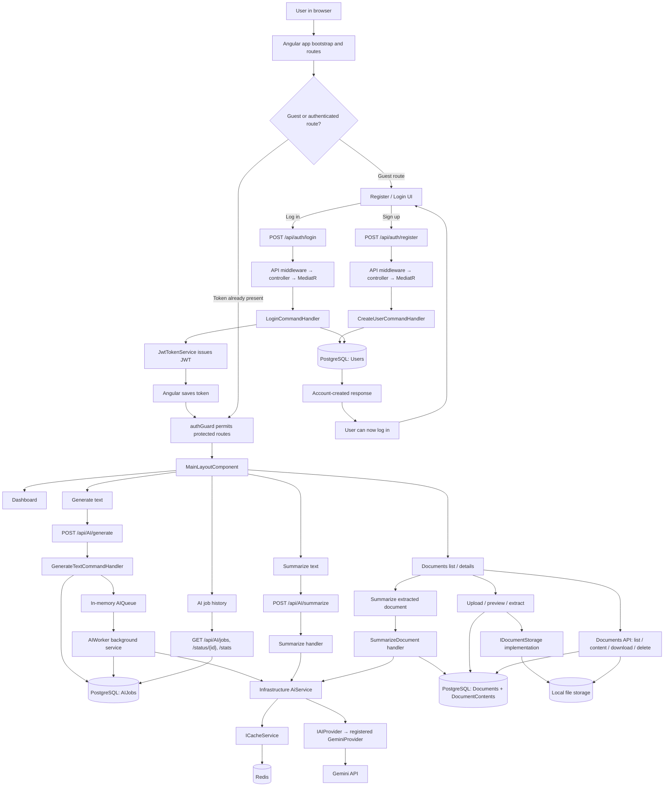

## 1.1 How to read the main request path

For a typical API request, the path is:

**Angular page → Angular service → HTTP interceptors → ASP.NET Core middleware → controller → MediatR → validation pipeline (where configured) → handler → Application interface → Infrastructure implementation → database/cache/file system/AI provider → response.**

Not every workflow uses every component. For example, a health check may not go through MediatR; login is anonymous and does not require a JWT; the background worker does not begin as an HTTP request; and text generation returns a job identifier before the AI work finishes.

## 1.2 Runtime boundaries

- **Browser / Angular:** renders screens, performs client-side form validation, stores the JWT using the current token service, and calls the REST API.
- **ASP.NET Core API:** receives HTTP requests, applies configured middleware and security, dispatches controller actions, and serializes responses.
- **Application:** contains commands, queries, handlers, validators, and abstractions.
- **Core:** domain entities and constants/enums.
- **Infrastructure:** database repositories, local document storage, PDF extraction, AI service/provider, Redis cache, job store, in-memory queue, and background worker.
- **External/local dependencies:** PostgreSQL, Redis, local file system, and Gemini API.

---

# 2. Shared foundation used by the workflows

This section explains the cross-cutting components once. Individual workflow chapters refer to these IDs instead of repeating the same theory.

## 2.1 ASP.NET Core request pipeline

**Source:** [BASE-01] `backend/API/Program.cs`

The currently configured order includes:

1. Exception handling middleware
2. Correlation ID middleware
3. Request logging middleware
4. CORS
5. Authentication
6. Authorization
7. Rate limiter
8. Controller endpoints (with the configured concurrency policy)
9. Custom health-check endpoints are mapped separately

Middleware order matters because each middleware wraps the next part of the pipeline. The exception middleware is registered before the correlation and request-logging middleware so it can catch downstream exceptions. The correlation middleware assigns or reuses the `X-Correlation-ID`; request logging then runs with that context available.

```mermaid
sequenceDiagram
    participant C as Angular / HTTP client
    participant E as ExceptionHandlingMiddleware
    participant R as CorrelationIdMiddleware
    participant L as RequestLoggingMiddleware
    participant CO as CORS
    participant AU as Authentication
    participant AZ as Authorization
    participant RL as Rate limiter
    participant EP as Controller endpoint
    C->>E: HTTP request
    E->>R: Continue
    R->>R: Reuse or create X-Correlation-ID
    R->>L: Continue with correlation context
    L->>CO: Start request timing / log request
    CO->>AU: Continue
    AU->>AZ: Establish principal from bearer token, if supplied
    AZ->>RL: Check endpoint access
    RL->>EP: Continue if admitted
    EP-->>L: Response or exception
    L-->>R: Log status and elapsed time
    R-->>E: Response carries correlation ID
    E-->>C: HTTP response; unhandled exceptions become standardized errors
```

**Important nuance:** middleware order in the diagram is based on registration in `Program.cs`; exact behavior on an exception depends on where it is thrown and how each middleware handles/rethrows it.

## 2.2 Global exception handling and API error shape

**Source files**
- [BASE-02] `backend/API/Middlewares/ExceptionHandlingMiddleware.cs`
- [BASE-03] `backend/Application/Common/Models/ApiResponse.cs`
- [BASE-04] `backend/Application/Common/Exceptions/` (custom exception types)
- [BASE-05] `backend/Application/Common/Behaviors/ValidationBehavior.cs`

The global exception middleware catches validation failures separately and converts them to a 400 response with a standardized failure payload. Other exceptions are logged and mapped through the middleware’s centralized exception-handling method. Workflow-specific chapters should describe the expected error cases but do not need to re-explain how the response is serialized.

A standardized response envelope improves consistency, but the actual HTTP status and payload depend on the exception mapping. When verifying a workflow, inspect both the status code and the JSON body; do not rely on a UI toast alone.

## 2.3 Correlation ID and request logging

**Source files**
- [BASE-06] `backend/API/Middlewares/CorrelationIdMiddleware.cs`
- [BASE-07] `backend/API/Middlewares/RequestLoggingMiddleware.cs`
- [BASE-01] `backend/API/Program.cs`

The correlation middleware uses an incoming `X-Correlation-ID` header when present, otherwise generates a GUID, stores it in request context, and adds it to the response. The request logging middleware measures elapsed time and logs request/response information; it logs and rethrows exceptions so the exception middleware can produce the client response. Serilog is configured for console and rolling JSON-file output.

**How to debug one request:** copy the response’s `X-Correlation-ID`, then search the backend logs for that ID. A correlation ID groups log events; it does not by itself guarantee that every external provider or background-job log is linked to the same ID.

## 2.4 Dependency injection and Clean Architecture

**Source files**
- [BASE-01] `backend/API/Program.cs`
- [BASE-08] `backend/Application/DependencyInjection.cs`
- [BASE-09] `backend/Infrastructure/DependencyInjection.cs`

The API registers Application and Infrastructure services. Application registers MediatR handlers, FluentValidation validators, and the validation pipeline behavior. Infrastructure maps interfaces to concrete implementations, configures EF Core/PostgreSQL, registers repositories and AI services, configures the named AI HTTP client’s retry/circuit-breaker/timeout policies, registers the in-memory queue, and starts the hosted AI worker.

The dependency direction is intentional: Application handlers depend on interfaces; Infrastructure supplies implementations. This keeps use-case logic from depending directly on a concrete database provider, local file store, or AI vendor.

## 2.5 MediatR, commands, queries, and validation

**Source files**
- [BASE-08] `backend/Application/DependencyInjection.cs`
- [BASE-05] `backend/Application/Common/Behaviors/ValidationBehavior.cs`
- Each workflow’s command/query, validator, and handler files

A controller translates an HTTP request into a command/query and sends it through MediatR. MediatR locates the registered handler. The validation behavior runs registered FluentValidation validators in the request pipeline; if validation fails, it throws a validation exception that the global middleware formats into a 400 response.

Not every request has a validator, and client-side validation is not a substitute for server-side validation.

## 2.6 JWT authentication, authorization, and current-user identity

**Source files**
- [BASE-10] `backend/API/Extensions/AuthExtensions.cs`
- [BASE-11] `backend/Infrastructure/Auth/JwtTokenService.cs`
- [BASE-12] `backend/Infrastructure/Services/CurrentUserService.cs`
- [BASE-13] `frontend/src/app/core/services/token.service.ts`
- [BASE-14] `frontend/src/app/core/interceptors/auth.interceptor.ts`
- [BASE-15] `frontend/src/app/core/guards/auth.guard.ts`
- [BASE-16] `frontend/src/app/core/guards/guest.guard.ts`

Login is anonymous; successful login returns a signed JWT. Angular stores it using the current token service. The auth interceptor adds `Authorization: Bearer <token>` to outgoing requests when a token exists. The frontend guards decide whether a route can be entered based on token presence. On the backend, JWT bearer authentication validates the token and creates the request principal; authorization policies/attributes decide whether that principal may call a protected endpoint.

**Security distinction:** frontend route guards improve navigation but are not security boundaries. Backend authentication and authorization must protect the API independently. The current `CurrentUserService` resolves the user ID from the authenticated principal; handlers/repositories use that identity to scope user-owned data.

## 2.7 Data access and persistence

**Source files**
- [BASE-17] `backend/Infrastructure/Data/AppDbContext.cs`
- [BASE-18] `backend/Infrastructure/Repositories/`
- [BASE-19] `backend/Infrastructure/Services/AIJobStore.cs`
- [BASE-20] relevant EF Core migrations

Handlers use Application interfaces. Infrastructure repositories and stores implement them with EF Core and `AppDbContext`. A call such as `SaveChangesAsync` persists tracked changes to PostgreSQL. Document metadata and extracted text are stored separately; the original file is currently handled through the storage abstraction and local storage implementation.

Never infer a foreign-key constraint, transaction boundary, or deletion cascade solely from a UML relationship: verify it in the entity configuration and migrations.

## 2.8 AI provider, cache, and resilience boundary

**Source files**
- [BASE-21] `backend/Infrastructure/AI/AiService.cs`
- [BASE-22] `backend/Infrastructure/AI/Providers/GeminiProvider.cs`
- [BASE-23] `backend/Infrastructure/AI/Providers/OpenAIProvider.cs`
- [BASE-24] `backend/Infrastructure/Resilience/AIResiliencePolicy.cs`
- [BASE-25] `backend/Infrastructure/Services/CacheService.cs`
- [BASE-09] `backend/Infrastructure/DependencyInjection.cs`

Application handlers call the AI service abstraction. The Infrastructure AI service uses the registered provider and cache service. The current registration selects `GeminiProvider`; the existence of an OpenAI provider class does **not** mean automatic fallback is active. The named HTTP client is configured with retry, circuit-breaker, and timeout policies; verify that a specific provider call actually uses that named client before assuming the policy protects it.

The cache is an optimization, not the source of truth. AI job state/results are persisted separately in PostgreSQL.

## 2.9 Frontend HTTP cross-cutting behavior

**Source areas**
- [BASE-26] `frontend/src/app/app.config.ts`
- [BASE-14] `frontend/src/app/core/interceptors/`
- [BASE-27] `frontend/src/app/core/services/` (loading, snackbar, authentication state, etc.)

The registered interceptors may attach the bearer token, show global loading state, and normalize/display errors. Feature services remain responsible for calling the appropriate API endpoint and mapping the response to their feature. Exact interceptor order and 401/403 handling should be checked in `app.config.ts` before debugging a specific failure.

## 2.10 Rate limiting, health checks, and configuration

**Source files**
- [BASE-01] `backend/API/Program.cs`
- [BASE-28] `backend/API/Extensions/HealthCheckExtensions.cs`
- API and Infrastructure configuration files

The API configures concurrency and fixed-window rate limiters. Health checks are registered and mapped through a custom extension. Connection strings, JWT settings, CORS origins, and provider configuration are environment-specific; secrets must not be placed in source control. For cloud deployment, these concerns need environment/secret-manager configuration rather than hard-coded local assumptions.

---

# 3. Workflow 01 — Signup and login

**Goal:** create an account, persist a password hash rather than the raw password, then authenticate and receive a JWT that the Angular client uses for protected API calls.

## 3.1 Signup — sequence diagram

```mermaid
sequenceDiagram
    actor U as User
    participant UI as RegisterComponent
    participant AS as AuthService
    participant I as Angular HTTP interceptors
    participant EX as ExceptionHandlingMiddleware
    participant CID as CorrelationIdMiddleware
    participant LOG as RequestLoggingMiddleware
    participant API as AuthController
    participant M as MediatR
    participant V as CreateUserCommandValidator / ValidationBehavior
    participant H as CreateUserCommandHandler
    participant R as IUserRepository / UserRepository
    participant DB as AppDbContext / PostgreSQL
    U->>UI: Enter name, email, password
    UI->>UI: Reactive form validation
    UI->>AS: register(RegisterRequest)
    AS->>I: POST /api/auth/register
    I->>EX: Request (no bearer token required)
    EX->>CID: Enter request pipeline
    CID->>LOG: Assign/propagate X-Correlation-ID
    LOG->>API: Log request; continue
    API->>M: Send CreateUserCommand
    M->>V: Run registered validation
    V-->>M: Continue if valid
    M->>H: Handle(command)
    H->>R: EmailExistsAsync(email)
    R->>DB: Query Users
    DB-->>R: Exists / does not exist
    alt Email already exists
        H-->>M: DuplicateEmailException
        M-->>API: Exception propagates out of Send
        API-->>LOG: Exception bubbles out of controller
        LOG-->>CID: Log failure and rethrow
        CID-->>EX: Exception reaches outer handler
        EX-->>I: 409 + ApiResponse failure
        I-->>UI: Error response
        UI-->>U: Show registration error
    else Email available
        H->>H: Hash password with BCrypt; assign User role
        H->>R: AddUserAsync(user)
        R->>DB: INSERT user + SaveChangesAsync
        DB-->>R: Persisted
        R-->>H: Complete
        H-->>M: Return new user ID
        M-->>API: User ID
        API-->>LOG: 200 + ApiResponse<Guid>
        LOG-->>CID: Log response status and duration
        CID-->>EX: Return response with correlation header
        EX-->>I: HTTP response
        I-->>UI: Account created
        UI-->>U: Show success; navigate to login
    end
```

## 3.2 Login — sequence diagram

```mermaid
sequenceDiagram
    actor U as User
    participant UI as LoginComponent
    participant AS as AuthService
    participant TS as TokenService
    participant EX as ExceptionHandlingMiddleware
    participant CID as CorrelationIdMiddleware
    participant LOG as RequestLoggingMiddleware
    participant API as AuthController
    participant M as MediatR
    participant V as LoginCommandValidator / ValidationBehavior
    participant H as LoginCommandHandler
    participant R as IUserRepository / UserRepository
    participant DB as AppDbContext / PostgreSQL
    participant JWT as JwtTokenService
    U->>UI: Enter email and password
    UI->>UI: Reactive form validation
    UI->>AS: login(LoginRequest)
    AS->>EX: POST /api/auth/login (anonymous)
    EX->>CID: Enter request pipeline
    CID->>LOG: Assign/propagate X-Correlation-ID
    LOG->>API: Log request; continue
    API->>M: Send LoginCommand
    M->>V: Validate email/password
    V-->>M: Continue if valid
    M->>H: Handle(command)
    H->>R: GetUserByEmailAsync(email)
    R->>DB: Query Users by email
    DB-->>R: User or no result
    alt User missing or password invalid
        H-->>M: UnauthorizedException
        M-->>API: Exception propagates out of Send
        API-->>LOG: Exception bubbles out of controller
        LOG-->>CID: Log failure and rethrow
        CID-->>EX: Exception reaches outer handler
        EX-->>UI: 401 + ApiResponse failure
        UI-->>U: Show login error
    else Credentials valid
        H->>H: BCrypt.Verify(entered password, stored hash)
        H->>JWT: GenerateToken(user)
        JWT->>JWT: Create claims + sign JWT + set issuer/audience/expiry
        JWT-->>H: JWT string
        H-->>M: LoginResponse(token, email)
        M-->>API: LoginResponse
        API-->>LOG: ApiResponse<LoginResponse>
        LOG-->>CID: Log response status and duration
        CID-->>EX: Return response with correlation header
        EX-->>AS: HTTP response
        AS->>TS: Save token in localStorage
        AS->>AS: Refresh current-user state
        AS-->>UI: Login observable succeeds
        UI->>UI: Navigate to /dashboard
    end
```

## 3.3 What happens on the next protected API request?

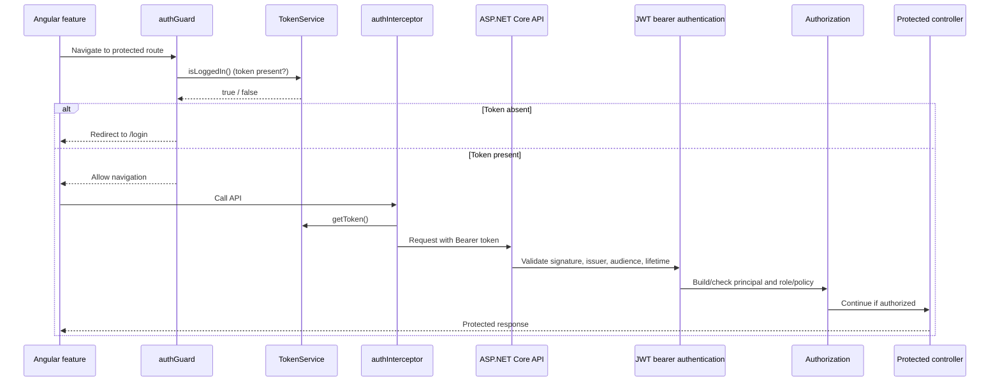

## 3.4 Source-file register for this workflow

| Ref | File | Responsibility |
|---|---|---|
| [AUTH-01] | `frontend/src/app/app.routes.ts` | Routes for login/register and guest/auth guards |
| [AUTH-02] | `frontend/src/app/features/auth/register/register.component.ts`, `register.component.html`, `register.component.css` | Signup form behavior, rendered fields, validation messages, success/error UI |
| [AUTH-03] | `frontend/src/app/features/auth/login/login.component.ts`, `login.component.html`, `login.component.css` | Login form behavior, rendered fields, validation messages, success/error UI |
| [AUTH-04] | `frontend/src/app/core/services/auth.service.ts` | Calls login/register endpoints; saves token after login |
| [AUTH-05] | `frontend/src/app/core/services/token.service.ts` | Reads/writes/removes JWT in localStorage |
| [AUTH-06] | `frontend/src/app/core/services/current-user.service.ts` | Refreshes frontend current-user state |
| [AUTH-07] | `frontend/src/app/core/interceptors/auth.interceptor.ts` | Adds bearer token when available |
| [AUTH-08] | `frontend/src/app/core/guards/auth.guard.ts` | Blocks protected route navigation without token |
| [AUTH-09] | `frontend/src/app/core/guards/guest.guard.ts` | Redirects signed-in browser away from guest routes |
| [AUTH-10] | `backend/API/Controllers/AuthController.cs` | Anonymous login/register HTTP endpoints; maps request to MediatR commands |
| [AUTH-10a] | `backend/API/Program.cs` | Registers middleware, Application/Infrastructure DI, controllers, rate limiting, auth |
| [AUTH-10b] | `backend/API/Middlewares/ExceptionHandlingMiddleware.cs` | Maps validation/business/unhandled exceptions to JSON API responses |
| [AUTH-10c] | `backend/API/Middlewares/CorrelationIdMiddleware.cs` | Adds/propagates `X-Correlation-ID` and logging scope |
| [AUTH-10d] | `backend/API/Middlewares/RequestLoggingMiddleware.cs` | Logs request outcome and elapsed time |
| [AUTH-10e] | `backend/API/Extensions/AuthExtensions.cs` | Configures JWT bearer validation and role policies |
| [AUTH-10f] | `backend/Application/Common/Models/ApiResponse.cs` | Standard success/failure response envelope |
| [AUTH-11] | `backend/Application/Features/Users/Commands/CreateUser/CreateUserCommand.cs` | Signup request command |
| [AUTH-12] | `backend/Application/Features/Users/Commands/CreateUser/CreateUserCommandValidator.cs` | Server-side validation for signup input |
| [AUTH-12a] | `backend/Application/Features/Auth/Commands/Login/LoginCommandValidator.cs` | Server-side login email/password validation through MediatR pipeline |
| [AUTH-13] | `backend/Application/Features/Users/Commands/CreateUser/CreateUserCommandHandler.cs` | Duplicate email check, BCrypt hash, role assignment, persistence request |
| [AUTH-14] | `backend/Application/Features/Auth/Commands/Login/LoginCommand.cs` | Login command contract |
| [AUTH-15] | `backend/Application/Features/Auth/Commands/Login/LoginCommandHandler.cs` | Fetch user, verify BCrypt hash, request JWT |
| [AUTH-16] | `backend/Application/DTOs/Auth/LoginRequest.cs` | Login HTTP request DTO |
| [AUTH-16a] | `backend/Application/Features/Auth/Commands/Login/LoginResponse.cs` | Login handler response contract |
| [AUTH-16b] | `frontend/src/app/core/models/auth/login-request.ts`, `login-response.ts`, `register-request.ts` | Angular request/response types |
| [AUTH-16c] | `frontend/src/app/core/constants/jwt-claims.ts`, `frontend/src/app/core/models/auth/jwt-payload.ts` | Claim names expected when decoding the token in the UI |
| [AUTH-17] | `backend/Application/Interfaces/IUserRepository.cs` | Application-facing user persistence abstraction |
| [AUTH-18] | `backend/Infrastructure/Repositories/UserRepository.cs` | EF Core implementation of user repository |
| [AUTH-19] | `backend/Core/Entities/User.cs` | User domain model |
| [AUTH-20] | `backend/Infrastructure/Data/AppDbContext.cs` | User DbSet and database mapping |
| [AUTH-21] | `backend/Infrastructure/Auth/JwtTokenService.cs` | Builds and signs JWT |
| [AUTH-22] | `backend/API/Extensions/AuthExtensions.cs` | JWT bearer validation and role policies |
| [AUTH-23] | `backend/Infrastructure/Auth/JwtSettings.cs`, `backend/API/appsettings.json` | JWT issuer, audience, expiry, and secret configuration shape; never commit real secrets |
| [AUTH-24] | `backend/Application/DependencyInjection.cs` | Registers MediatR handlers, validators, and validation pipeline |
| [AUTH-25] | `backend/Infrastructure/DependencyInjection.cs` | Registers repositories, DbContext, token service, and current-user service |
| [AUTH-26] | `backend/Application/Common/Behaviors/ValidationBehavior.cs` | Runs validators before the selected handler |
| [AUTH-27] | `backend/Infrastructure/Services/CurrentUserService.cs` | Resolves authenticated user ID from request claims for protected workflows |
| [AUTH-28] | `backend/Infrastructure/Migrations/AppDbContextModelSnapshot.cs` | Snapshot used to inspect the currently modelled Users schema/indexes |
| [AUTH-29] | `frontend/src/app/core/services/current-user.service.ts`, `frontend/src/app/core/guards/auth.guard.ts`, `guest.guard.ts`, `frontend/src/app/core/interceptors/auth.interceptor.ts` | Frontend claim state, route gating, and bearer-token attachment |
| [AUTH-30] | [BASE-01], [BASE-02], [BASE-05], [BASE-08], [BASE-09] | Shared cross-cutting behavior documented in Chapter 2 |

## 3.5 Necessary theory, linked to source references

Use the bracketed IDs in the source register as the references for this chapter. They are documentation labels only; no numbered comments are being added to application code.

- **[THEORY-01 — Request validation]** The Angular forms provide immediate feedback, but they are not a security boundary. The API's MediatR validation behavior runs the matching FluentValidation validator before the handler ([AUTH-12], [AUTH-12a], [AUTH-24], [AUTH-26]). Invalid signup/login input should fail before any repository lookup or insert.
- **[THEORY-02 — Password handling]** Signup hashes the password with BCrypt before constructing the persisted user ([AUTH-13]). The raw password must never be stored. Login verifies the submitted password against the saved hash; it does not decrypt the hash ([AUTH-15]).
- **[THEORY-03 — Duplicate email and database integrity]** The signup handler performs an existence check before insert ([AUTH-13], [AUTH-18]). The current EF model snapshot shows no unique index on `Users.Email` ([AUTH-20], [AUTH-28]). Therefore, duplicate prevention is currently application-level; concurrent registrations can race. Add a database uniqueness constraint in a deliberate stabilization change and handle its database exception, after checking existing data.
- **[THEORY-04 — JWT]** The token carries subject/user ID, email, full name, and role claims ([AUTH-21]). The API validates signature, issuer, audience, and lifetime and maps the role claim for policy checks ([AUTH-22], [AUTH-23]). A decoded token in the browser is only client-side state; the API is the authority that validates it.
- **[THEORY-05 — Anonymous vs protected access]** Login and registration are explicitly anonymous ([AUTH-10]). Angular route guards only control navigation in the browser ([AUTH-08], [AUTH-09]); backend authentication/authorization remains mandatory for protected endpoints ([AUTH-22]).
- **[THEORY-06 — Shared request behavior]** For each HTTP request, the global exception handler surrounds the downstream pipeline; correlation middleware assigns or accepts `X-Correlation-ID`; request logging records duration/status; authentication builds a principal from a valid bearer token; authorization checks endpoint policies ([AUTH-10a]–[AUTH-10e], Chapter 2). MediatR validation runs only when the controller sends a command/query through MediatR.
- **[THEORY-07 — Response contract]** Successful auth endpoints return `ApiResponse<T>`; validation and domain failures are formatted by the global exception middleware ([AUTH-10b], [AUTH-10f]). The frontend currently reads `error.error?.message`, so response-shape consistency is important.
- **[THEORY-08 — Current-user state]** After login, Angular stores the JWT in `localStorage` and decodes claims to populate current-user UI state ([AUTH-04]–[AUTH-06], [AUTH-16c]). This is the current implementation, not a claim that localStorage is the strongest token-storage option. Review token storage as a separate security-hardening decision.
- **[THEORY-09 — Email normalization]** The current existence lookup compares the supplied email directly with the stored email ([AUTH-18]). No normalization/case-folding is visible in this path. Decide on a consistent case-insensitive email policy and enforce it at both application and database levels before production.
- **[THEORY-10 — Runtime evidence]** Source tracing establishes the intended control flow, but does not prove the running database schema, live API status codes, CORS setup, JWT secret quality, or actual logs. The verification checklist below must be run against the local application and its real PostgreSQL database before marking this chapter verified.

## 3.6 Verification checklist

- [ ] Register with valid name/email/password; verify a new Users row exists.
- [ ] Confirm the persisted password is a BCrypt hash, not the original password.
- [ ] Register the same email again; verify the API returns a failure response.
- [ ] Register with invalid email or short password; verify server-side validation rejects it.
- [ ] Login with correct credentials; verify response includes a JWT and frontend stores it.
- [ ] Login with wrong password and with unknown email; verify the public message does not disclose which part was incorrect.
- [ ] Call a protected endpoint with no token, an invalid token, an expired token, and a valid token.
- [ ] Verify the response contains `X-Correlation-ID` and that matching backend log events can be found.
- [ ] Verify role-restricted endpoints reject a normal User token.

**Status:** source traced for the main registration/login path and shared middleware/configuration references. Runtime verification is pending. Two concrete hardening findings are recorded: no unique `Users.Email` index appears in the EF model snapshot, and email comparison/normalization policy is not explicit. Do not silently change these as part of diagram writing; resolve them in the stabilization backlog with a migration and tests.

---

# 4. Workflow 02 — Asynchronous text generation and job polling

**Goal:** accept a prompt quickly, persist a job, enqueue it, process it in the background, and let the browser poll the current user’s job status/result.

## 4.1 Sequence diagram

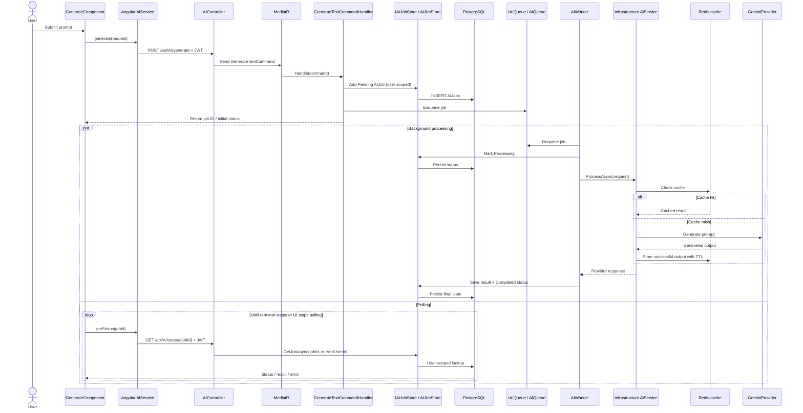

## 4.2 Failure and recovery branches

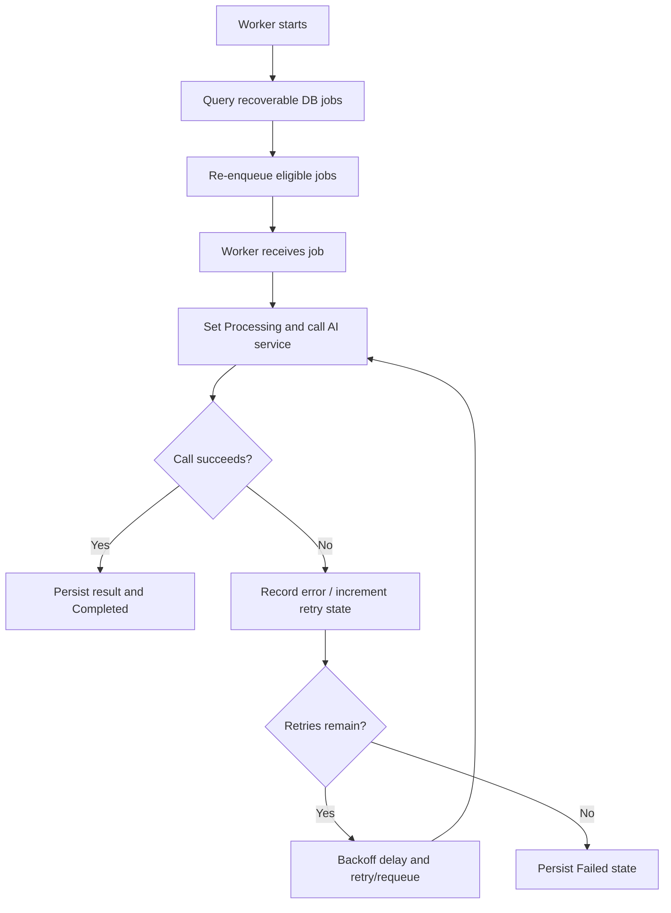

The queue is currently in-memory. Database recovery on worker startup mitigates some loss scenarios, but the queue is not a durable distributed broker and the design does not guarantee exactly-once execution. Duplicate processing and process-crash timing must be considered when validating failure behavior.

## 4.3 Source-file register

| Ref | File | Responsibility |
|---|---|---|
| [GEN-01] | `frontend/src/app/features/ai/generate/generate.component.ts` | Prompt form, submission and status polling UI |
| [GEN-02] | `frontend/src/app/core/services/ai.service.ts` | Calls generation and status endpoints |
| [GEN-03] | `backend/API/Controllers/AIController.cs` | Generation and status HTTP endpoints |
| [GEN-04] | `backend/Application/Features/AI/Commands/GenerateText/GenerateTextCommand.cs` | Generation command contract |
| [GEN-05] | `backend/Application/Features/AI/Commands/GenerateText/GenerateTextCommandHandler.cs` | Creates/persists job and enqueues it |
| [GEN-06] | `backend/Core/Entities/AIJob.cs` | Persistent job model |
| [GEN-07] | `backend/Application/Interfaces/IAIQueue.cs` | Queue abstraction |
| [GEN-08] | `backend/Infrastructure/Services/AIQueue.cs` | Current in-memory queue implementation |
| [GEN-09] | `backend/Infrastructure/BackgroundServices/AIWorker.cs` | Background processing, retry, and recovery logic |
| [GEN-10] | `backend/Application/Interfaces/IAIJobStore.cs` | Job-store abstraction |
| [GEN-11] | `backend/Infrastructure/Services/AIJobStore.cs` | PostgreSQL job persistence and user-scoped lookup |
| [GEN-12] | `backend/Application/Interfaces/IAIService.cs` and AI request/response contracts | AI processing boundary |
| [GEN-13] | [BASE-21] through [BASE-25] | Provider, cache and resilience path |
| [GEN-14] | `backend/Infrastructure/Data/AppDbContext.cs` | AIJobs mapping and indexes |

## 4.4 Necessary theory and implementation notes

- **Why asynchronous:** the API can return a job ID without holding the HTTP request open for the entire model response.
- **Persist before enqueue:** the job record is created before the queue is used, allowing the worker to recover eligible jobs from PostgreSQL after restart.
- **Polling:** the frontend periodically asks for status. The backend lookup must include the authenticated user ID so one user cannot read another user’s job.
- **Terminal states:** verify the exact enum/status transitions in `AIJobStatus` and `AIWorker.cs`; document the actual terminal states after tracing that file.
- **Retry policy layers:** worker-level job retries and HTTP-level Polly retries are different mechanisms. Their combined effect depends on the provider’s HTTP client usage.
- **Legacy project field:** `ProjectId` is a legacy prototype concept and is not a product requirement. It should be removed only after all source references, schema migrations, tests, and existing data implications are reviewed.

## 4.5 Verification checklist

- [ ] Submit a valid prompt and verify the API returns a job ID.
- [ ] Verify a Pending/initial job row is persisted for the current user.
- [ ] Verify the worker moves the job through processing to Completed and stores the output.
- [ ] Verify the frontend displays the result without refreshing the page.
- [ ] Verify job status/result cannot be read by another user.
- [ ] Cause a safe provider failure in a development environment; observe retry counts, backoff and eventual Failed state.
- [ ] Restart the worker/API with a recoverable job and verify the actual recovery behavior.
- [ ] Confirm correlation/log fields available for the API request and background processing; do not assume the HTTP correlation ID automatically propagates into the worker.
- [ ] Test duplicate/restart timing and record any at-least-once processing behavior.

**Status:** main request, queue, worker, retry, recovery, cache/provider and polling paths traced directly from source. Runtime verification remains pending; source-level findings are recorded in Sections 4.6–4.7.

---

## 4.6 Source-traced implementation findings

The current source was checked directly for the Angular component, API controller, command handler, queue, worker, job store, status handler, AI service, and dependency-injection registration. The following are implementation facts or source-level findings, not runtime test results.

- **Retry count:** AIJob defaults MaxRetries to 3. AIWorker increments RetryCount on failure; it retries while RetryCount is less than MaxRetries, using a delay of 2 raised to RetryCount seconds. This normally permits up to three processing attempts total when failures reach the standard retry branch.
- **Startup recovery:** the worker queries Pending, Processing, and Retrying jobs. It resets recovered Processing jobs to Pending, re-enqueues eligible jobs, and marks jobs Failed during recovery when RetryCount is already at or above MaxRetries.
- **Ownership:** GetAIStatusQueryHandler passes the authenticated user ID to AIJobStore.GetJobAsync; the EF query filters by both job ID and user ID. A job that does not match the caller is returned as Not Found.
- **Prompt validation gap:** no GenerateTextCommandValidator.cs exists at the expected feature path in the current repository, and the inspected GenerateComponent form has no visible required/minimum-length validator. Decide prompt constraints and add server-side validation during stabilization.
- **Polling lifecycle:** GenerateComponent uses interval(2000), which waits two seconds before its first emission. The polling subscription has no explicit error callback and is not retained for cleanup when the component is destroyed. These should be addressed during stabilization.
- **Shutdown behavior:** cancellation during worker processing exits the current loop path without explicitly persisting a replacement status in that catch block. Startup recovery may handle a job left Processing; confirm this through the consolidated runtime test pass.
- **Legacy ProjectId:** GenerateTextCommandHandler still sets ProjectId to a newly generated GUID. This is a leftover prototype field, not a meaningful product project relationship, and must be removed only after auditing every source/schema/migration reference.
- **Provider resilience:** GeminiProvider was traced and does create the named AIClient through IHttpClientFactory, so the retry, circuit-breaker, and timeout handlers registered on that named client are in its request path.
- **Cache behavior:** AiService treats Redis get/set failures as non-fatal and caches successful output for ten minutes. PostgreSQL job state remains separate from the cache.

These findings are recorded for the final stabilization backlog. No local build, API call, or runtime test was executed as part of this source-tracing update.

## 4.7 Expanded final verification checklist

- [ ] Submit a valid prompt and verify the API returns a job ID and initial status.
- [ ] Verify the job row is persisted for the authenticated user before processing starts.
- [ ] Verify the worker persists Processing, then Completed and the output.
- [ ] Verify the UI displays the result without refreshing.
- [ ] Verify Pending, Processing, Retrying, Completed and Failed render correctly.
- [ ] Verify another user cannot read the job status/result by using the job ID.
- [ ] Test blank and very long prompts after prompt constraints are agreed.
- [ ] Cause a safe provider failure in development; observe retry count, exponential backoff and eventual Failed state.
- [ ] Restart the API/worker with Pending, Processing and Retrying jobs and record recovery behavior.
- [ ] Navigate away during polling and confirm no polling continues after component destruction once cleanup is implemented.
- [ ] Simulate a status endpoint failure and confirm the UI reports it intentionally.
- [ ] Check logs for job ID and correlation ID; do not assume the HTTP correlation ID propagates automatically into worker logs.
- [ ] Record whether duplicate provider calls can occur around process-restart/crash boundaries.

# 5. Workflow 03 — Plain-text summarization

**Goal:** submit text for a summary and return the output synchronously within the HTTP request.

## 5.1 Sequence diagram

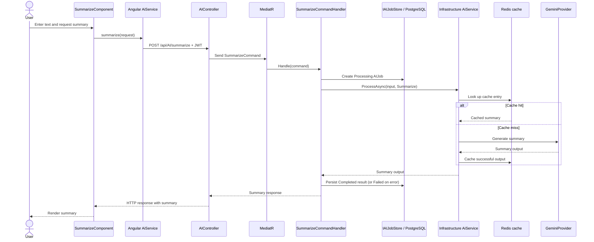

## 5.2 Source-file register

| Ref | File | Responsibility |
|---|---|---|
| [SUM-01] | `frontend/src/app/features/ai/summarize/summarize.component.ts` | Text input and summary UI |
| [SUM-02] | `frontend/src/app/core/services/ai.service.ts` | Calls plain-text summary endpoint |
| [SUM-03] | `backend/API/Controllers/AIController.cs` | `POST /api/AI/summarize` |
| [SUM-04] | `backend/Application/Features/AI/Commands/Summarize/SummarizeCommand.cs` | Command contract |
| [SUM-05] | `backend/Application/Features/AI/Commands/Summarize/SummarizeCommandHandler.cs` | Synchronous orchestration and job persistence |
| [SUM-06] | [BASE-21] through [BASE-25] | AI service, provider, cache and resilience |
| [SUM-07] | [BASE-19], [BASE-20] | AI job persistence and database mapping |

## 5.3 Necessary theory and implementation notes

This path is intentionally synchronous for the current lightweight workload; it should not be forced through the background queue solely for uniformity. The trade-off is that the HTTP request remains open until the summary call completes. If real workload or latency justifies it later, revisit that decision based on measured behavior.

The handler creates and updates an AI job for tracking, but the client receives the summary directly in the same request. Verify how failures are persisted and mapped to the API response.

## 5.4 Verification checklist

- [ ] Submit representative short, long, empty, and malformed inputs.
- [ ] Verify the returned summary is rendered immediately without a page refresh.
- [ ] Verify successful output is persisted and the job state is correct.
- [ ] Verify provider failure produces a useful error response and the expected persisted failure state.
- [ ] Verify the endpoint requires authentication and does not expose another user’s job/result.

**Status:** synchronous handler, frontend response rendering, AI service, provider and cache paths traced directly from source. Runtime verification remains pending; findings are recorded in Section 5.5.

---

## 5.5 Source-traced implementation findings

Direct inspection of SummarizeCommandHandler, SummarizeComponent, AiService, GeminiProvider, and Infrastructure dependency injection confirms:

- The handler creates a Processing AIJob before calling the AI service, then persists Completed/result on success. On exceptions it records Failed/error/CompletedAt and rethrows so the shared API exception middleware can format the HTTP failure.
- The handler has a CancellationToken parameter but does not pass it into IAIService.ProcessAsync. The call therefore uses the interface’s default token rather than the request token. Pass the token through during stabilization.
- No SummarizeCommandValidator.cs exists at the expected feature path, and the inspected form has no visible required/minimum-length validation. Define and enforce server-side text-size/empty-input rules.
- The handler still assigns a random ProjectId, which is a legacy prototype field to remove only after a repository-wide schema/migration audit.
- GeminiProvider calls IHttpClientFactory.CreateClient("AIClient"), so it uses the named client configured with retry, circuit-breaker, and 60-second timeout policies in Infrastructure dependency injection.
- AiService constructs the cache key by concatenating the operation type and full input text, then includes that key in cache-related log messages. This can expose user-provided text in logs and create very large cache keys. Replace raw input in keys/logs with a stable digest and review log data handling.
- The frontend assigns response.data.output to resultText and renders it immediately through MarkdownService. The source path itself is wired for immediate rendering; if a runtime display defect is observed, capture the actual response envelope and component state before changing this code.

These are source-level observations. They have not been verified through a local runtime test in this documentation pass.

## 5.6 Expanded final verification checklist

- [ ] Submit non-empty text and confirm the summary appears without a page refresh.
- [ ] Test empty, whitespace-only, very long and Unicode input after limits are decided.
- [ ] Verify the API requires authentication and the request reaches the intended handler.
- [ ] Verify an AIJob is persisted as Processing before the provider call and Completed with output on success.
- [ ] Force a safe provider failure in development; verify Failed/error state is persisted and the HTTP response is consistent.
- [ ] Confirm the provider request uses the named AIClient policies and observe timeout/retry behavior safely.
- [ ] Verify cache hit/miss behavior without exposing raw user text in application logs.
- [ ] Confirm cancellation of an HTTP request is propagated to the AI provider after the cancellation-token fix.
- [ ] Confirm output is rendered via the existing Markdown sanitization path.

# 6. Workflow 04 — Document upload and PDF preview

**Goal:** upload a PDF, persist its metadata and file, then retrieve the original PDF for preview.

## 6.1 Sequence diagram

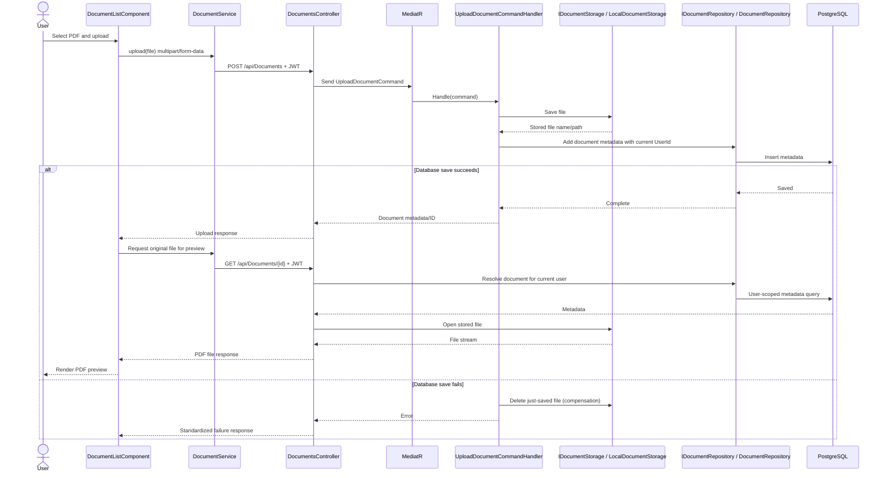

## 6.2 Source-file register

| Ref | File | Responsibility |
|---|---|---|
| [DOC-UP-01] | `frontend/src/app/features/documents/pages/document-list/document-list.component.ts` | Upload and list UI |
| [DOC-UP-02] | `frontend/src/app/features/documents/pages/document-details/document-details.component.ts` | Preview state and document-detail UI |
| [DOC-UP-03] | `frontend/src/app/core/services/document.service.ts` | Upload/list/download API calls |
| [DOC-UP-04] | `backend/API/Controllers/DocumentsController.cs` | Upload and original-file download endpoints |
| [DOC-UP-05] | `backend/Application/Features/Documents/Commands/UploadDocument/UploadDocumentCommand.cs` | Upload command contract |
| [DOC-UP-06] | `backend/Application/Features/Documents/Commands/UploadDocument/UploadDocumentCommandHandler.cs` | Coordinates storage and metadata persistence |
| [DOC-UP-07] | `backend/Application/Interfaces/IDocumentStorage.cs` | Storage abstraction |
| [DOC-UP-08] | `backend/Infrastructure/Storage/LocalDocumentStorage.cs` | Current local file implementation |
| [DOC-UP-09] | `backend/Application/Interfaces/IDocumentRepository.cs` | Metadata persistence abstraction |
| [DOC-UP-10] | `backend/Infrastructure/Repositories/DocumentRepository.cs` | User-scoped metadata queries |
| [DOC-UP-11] | `backend/Core/Entities/Document.cs` | Document metadata model |
| [DOC-UP-12] | [BASE-17], [BASE-20] | EF Core mapping and migrations |

## 6.3 Necessary theory and implementation notes

The database row and physical file are two separate resources, so a database transaction alone cannot atomically commit both. The handler currently compensates for a metadata-save failure by deleting the file it just saved. That is useful but should not be described as a distributed transaction.

The storage interface is the intended replacement point for a future S3 implementation. The API must verify ownership before serving the file. The original PDF preview is different from extracted text; upload does not itself mean text extraction has occurred.

**Known UI improvement:** the document-details page currently finds metadata by loading the first page of up to 100 documents and searching locally. This can fail for documents outside that page. Track it as a confirmed improvement to address during stabilization; do not misrepresent it as a backend ownership defect.

## 6.4 Verification checklist

- [ ] Upload a valid PDF and verify both file and metadata exist.
- [ ] Upload an invalid/oversized file and verify the actual validation response.
- [ ] Simulate metadata persistence failure safely and check file cleanup.
- [ ] Open the document details page and verify the original PDF previews without automatic extraction.
- [ ] Request another user’s document ID and verify the file is not disclosed.
- [ ] Delete a document and verify both metadata and file behavior in Chapter 08.
- [ ] Verify file-size formatting and PDF preview error states in the UI.

**Status:** main source path traced; upload limits and runtime failure handling require verification.

---

## 6.5 Source-traced upload and preview findings

Direct inspection of DocumentsController, UploadDocumentCommandHandler, LocalDocumentStorage, DocumentRepository, DocumentService, and DocumentListComponent confirms:

- The upload endpoint currently rejects only a missing or zero-length file at the controller boundary. No explicit extension/content-type allowlist or maximum file size was found in the inspected upload path. Because ContentType and FileName originate from the client, define and enforce upload limits and accepted formats on the server before production.
- The handler saves the physical file first, then writes metadata to PostgreSQL. If metadata persistence fails, it attempts to delete the saved file as compensation. This does not cover every process-crash window between file write and database insert.
- LocalDocumentStorage stores files under a Storage/Documents folder rooted at Directory.GetCurrentDirectory(). This is appropriate only while the deployment layout guarantees that path is writable and persistent; the future storage abstraction is the seam for S3.
- The original-file GET endpoint returns a file stream from the metadata/content-type data. It is protected by the controller-level Authorize attribute, and the GetDocument query must continue to scope metadata lookup to the current user before opening the stored file.
- DocumentListComponent calls router.navigate(['/documents', documentModel.id]) and then has a separate object literal containing state that is not passed to navigate. Therefore that state object has no effect. If document details expects navigation state, fix it or remove the dead expression during stabilization.
- The document-list upload handler refreshes the list after upload; it does not automatically open the uploaded document. That is distinct from the desired preview behavior after the user opens a document.
- The list’s file-size formatter currently uses two decimal places and includes a space between value and unit. Align the display with the preferred concise formatting during UI polish if that remains the desired standard.

These findings are source-level only. Validate accepted file types, maximum size, preview/download behavior, and rollback paths in the final test pass.

## 6.6 Expanded final verification checklist

- [ ] Upload a valid PDF and verify both the physical file and metadata row exist.
- [ ] Verify an unsupported file type and oversized file are rejected after server-side constraints are implemented.
- [ ] Upload an empty file and confirm the API returns a controlled client error.
- [ ] Verify one user cannot preview, download, extract or delete another user’s document.
- [ ] Verify a metadata-save failure triggers file cleanup, and document the crash window that compensation cannot cover.
- [ ] Verify preview and download return the expected content type and filename.
- [ ] Verify storage survives application restarts in the intended local environment.
- [ ] Verify document-list refresh, pagination, opening details, and navigation state.
- [ ] Confirm local storage path and writable permissions are explicit configuration assumptions.

# 7. Workflow 05 — Document text extraction

**Goal:** read the uploaded file, extract text from the PDF, persist extracted text, and return it to the UI.

## 7.1 Sequence diagram

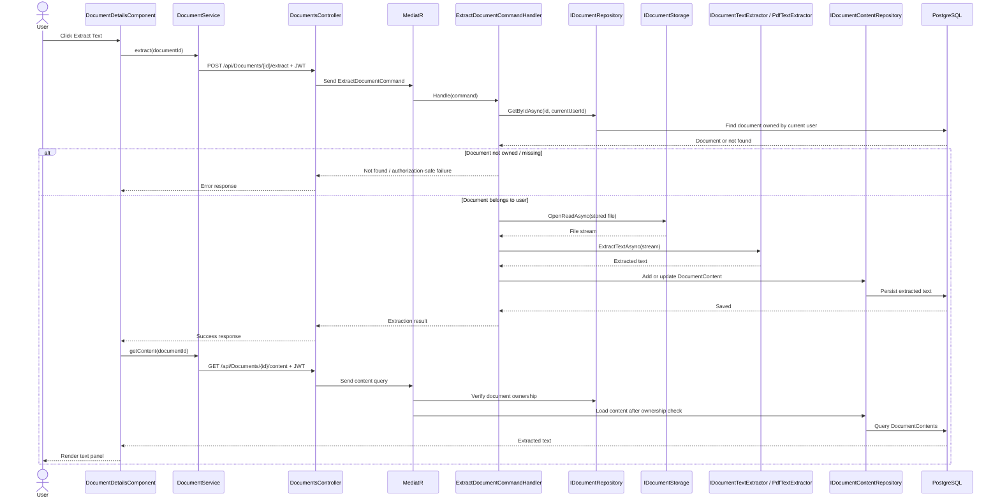

## 7.2 Source-file register

| Ref | File | Responsibility |
|---|---|---|
| [DOC-EX-01] | `frontend/src/app/features/documents/pages/document-details/document-details.component.ts` | Starts extraction and displays extracted text |
| [DOC-EX-02] | `frontend/src/app/core/services/document.service.ts` | Extraction and content retrieval calls |
| [DOC-EX-03] | `backend/API/Controllers/DocumentsController.cs` | Extract and content endpoints |
| [DOC-EX-04] | `backend/Application/Features/Documents/Commands/ExtractDocument/ExtractDocumentCommand.cs` | Extraction command contract |
| [DOC-EX-05] | `backend/Application/Features/Documents/Commands/ExtractDocument/ExtractDocumentCommandHandler.cs` | Ownership check, storage read, extraction and persistence |
| [DOC-EX-06] | `backend/Application/Interfaces/IDocumentTextExtractor.cs` | Text-extraction abstraction |
| [DOC-EX-07] | `backend/Infrastructure/DocumentProcessing/PdfTextExtractor.cs` | PDF text extraction implementation |
| [DOC-EX-08] | `backend/Application/Interfaces/IDocumentContentRepository.cs` | Extracted-content abstraction |
| [DOC-EX-09] | `backend/Infrastructure/Repositories/DocumentContentRepository.cs` | Extracted text persistence |
| [DOC-EX-10] | `backend/Core/Entities/DocumentContent.cs` | Extracted content entity |
| [DOC-EX-11] | [BASE-17], [BASE-20] | Relationship/migration details |

## 7.3 Necessary theory and implementation notes

Metadata about the uploaded file and its extracted text are separate records. Extraction reads the stored original file and creates or updates the related content record. It is important to check document ownership before accessing either the file or its extracted text. The repository’s content lookup may use document ID alone, so the caller’s ownership check is part of the security boundary and must not be skipped.

PDF text extraction does not guarantee OCR for image-only/scanned PDFs unless the implementation explicitly includes OCR. Verify the extractor’s actual capabilities before promising support for scanned documents.

## 7.4 Verification checklist

- [ ] Extract a text-based PDF and verify extracted text is saved.
- [ ] Repeat extraction and verify the intended add/update behavior.
- [ ] Test an image-only/scanned PDF and record the actual outcome.
- [ ] Request content for a nonexistent document and another user’s document.
- [ ] Verify the UI updates immediately after the extraction response without needing a page refresh.
- [ ] Test empty extraction output and extraction exceptions.

**Status:** source path traced at a high level; extractor-specific behavior and runtime results pending.

---

## 7.5 Source-traced extraction findings

Direct inspection of ExtractDocumentCommandHandler, PdfTextExtractor, and DocumentContentRepository confirms:

- The handler checks document ownership through DocumentRepository.GetByIdAsync(documentId, currentUserId) before opening the stored file. This is the primary ownership gate for extraction.
- PdfTextExtractor uses PdfPig and ContentOrderTextExtractor to extract selectable PDF text. The contentType parameter is accepted but not used to select an extractor. No OCR path is present in this implementation, so image-only/scanned PDFs may produce little or no text.
- Extracted text is stored in DocumentContents. Existing content is updated and its ExtractedAt timestamp refreshed; otherwise a new DocumentContent row is inserted.
- DocumentContentRepository queries by DocumentId alone. The inspected extraction handler performs the document ownership check first; keep that calling convention intact, and consider making the ownership relationship more explicit at the repository/interface boundary during hardening.
- Extraction is synchronous inside the HTTP request and reads the PDF pages in-process. Large or malformed PDFs may consume request time and memory; upload limits and cancellation behavior should be verified before production.

## 7.6 Expanded final verification checklist

- [ ] Extract text from a normal text-based PDF and verify page text is persisted and returned.
- [ ] Re-run extraction and verify the existing content row is updated rather than duplicated.
- [ ] Test a scanned/image-only PDF and record the expected no-OCR limitation.
- [ ] Test malformed, empty, large and multi-page PDFs with controlled error handling.
- [ ] Verify a different user cannot extract or read the document content.
- [ ] Verify the UI updates extracted text immediately and after a page reload.
- [ ] Confirm cancellation and request-timeout behavior for a long extraction.

# 8. Workflow 06 — Document summarization and saved summary retrieval

**Goal:** summarize text previously extracted from a user-owned document, return the result in the current request, persist the completed result, and allow a later request to retrieve the latest saved summary.

## 8.1 Sequence diagram

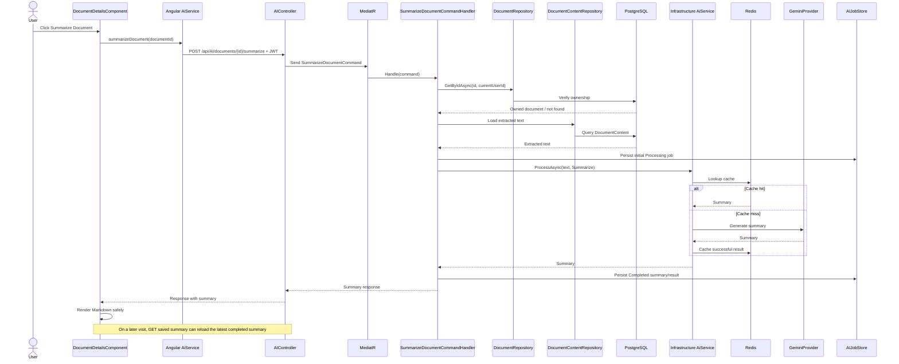

## 8.2 Saved-summary retrieval

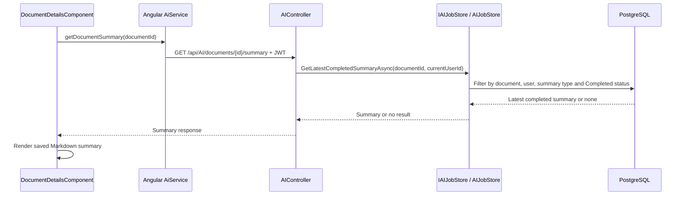

## 8.3 Source-file register

| Ref | File | Responsibility |
|---|---|---|
| [DOC-SUM-01] | `frontend/src/app/features/documents/pages/document-details/document-details.component.ts` | Summary action, loading state, Markdown rendering, saved-summary reload |
| [DOC-SUM-02] | `frontend/src/app/core/services/ai.service.ts` | Document-summary and saved-summary API calls |
| [DOC-SUM-03] | `backend/API/Controllers/AIController.cs` | Document summarize and saved-summary endpoints |
| [DOC-SUM-04] | `backend/Application/Features/AI/Commands/SummarizeDocument/SummarizeDocumentCommand.cs` | Command contract |
| [DOC-SUM-05] | `backend/Application/Features/AI/Commands/SummarizeDocument/SummarizeDocumentCommandHandler.cs` | Ownership, content retrieval, AI call and job state |
| [DOC-SUM-06] | `backend/Infrastructure/Services/AIJobStore.cs` | Latest completed summary lookup scoped to document and user |
| [DOC-SUM-07] | [BASE-21] through [BASE-25] | AI provider/cache/resilience |
| [DOC-SUM-08] | `frontend/package.json` and the document-details component | Markdown parser/sanitization dependency and rendering use |

## 8.4 Necessary theory and implementation notes

This workflow is synchronous in the current implementation. It depends on text having been extracted already. Document ownership must be checked before loading extracted text. The saved-summary query is scoped to both document and user and filters for the expected summary/completed state.

The frontend uses Markdown rendering and sanitization; raw model output must not be treated as trusted HTML. A previously observed UI issue was that the summary could appear in the network response but not update on screen until refresh. That is a runtime correctness issue to verify and fix if it still reproduces; the sequence diagram describes the intended current code path, not a claim that this UI bug is already resolved.

## 8.5 Verification checklist

- [ ] Attempt summarization before extraction and verify the API response.
- [ ] Summarize a document and verify the response appears immediately in the UI.
- [ ] Verify the job/result is persisted and saved-summary retrieval works after refresh.
- [ ] Verify a different user cannot summarize or retrieve another user’s document summary.
- [ ] Verify Markdown headings/lists are rendered and unsafe HTML is sanitized.
- [ ] Force an AI-provider failure and verify persisted status plus API/UI error behavior.

**Status:** key ownership and persistence path identified; live UI behavior and exact response contracts need runtime verification.

---

## 8.6 Source-traced document-summary findings

Direct inspection of SummarizeDocumentCommandHandler, GetDocumentSummaryQueryHandler, AIJobStore, and DocumentDetailsComponent confirms:

- The summarization handler verifies document ownership before querying extracted content, rejects missing/blank extracted text, creates a Processing AIJob associated with the document and current user, calls the shared AI service, then persists Completed/result or Failed/error.
- The handler accepts a CancellationToken but does not pass it to IAIService.ProcessAsync, so provider work is not currently linked to the HTTP request cancellation token. Pass it through during stabilization.
- Saved-summary retrieval searches for the latest completed Summarize job matching both document ID and current user ID, and returns an empty summary response when none exists.
- The Angular details component explicitly reloads both extracted content and saved summary when opening the document. On a successful summary response it updates local summary state and sanitizes Markdown-generated HTML using DOMPurify.
- The details page still loads up to 100 document metadata records and searches the page in the browser. This is not a scalable single-document lookup and can falsely behave as though a valid document is missing if it falls outside that page.
- The handler also assigns a random legacy ProjectId to the summary job. Remove that only with the wider legacy field/schema migration.
- Because the full extracted text is passed to the same AI service/cache path, the raw-input cache-key/logging concern described in Chapter 5 also applies to document content, which may be more sensitive than ordinary prompts.

## 8.7 Expanded final verification checklist

- [ ] Summarize a document after successful extraction and verify output is returned immediately.
- [ ] Try summarization before extraction; verify the UI either performs the intended extraction-first path or reports a clear failure.
- [ ] Verify missing/blank extracted content produces a controlled response.
- [ ] Verify the summary job is linked to the correct user and document and reaches Completed or Failed.
- [ ] Verify the summary appears immediately without refreshing and is restored after reopening the document.
- [ ] Verify a different user cannot summarize or retrieve another user’s document summary.
- [ ] Verify saved-summary lookup returns the latest completed summary when multiple summaries exist.
- [ ] Test provider failure, cancellation, large extracted text, and cache behavior safely.
- [ ] Replace the client-side first-100 metadata search with an ID-specific user-scoped document query during stabilization.

# 9. Workflow 07 — Job history, status, and statistics

**Goal:** retrieve only the authenticated user’s AI jobs, inspect a specific job, and show job statistics.

## 9.1 Sequence diagram

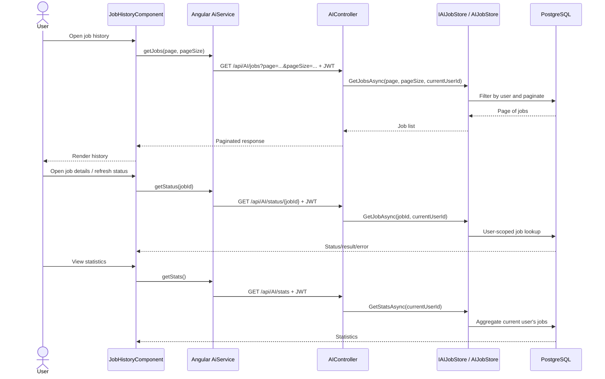

## 9.2 Source-file register

| Ref | File | Responsibility |
|---|---|---|
| [HIST-01] | `frontend/src/app/features/ai/job-history/job-history.component.ts` | Job list and interactions |
| [HIST-02] | Job details dialog under `frontend/src/app/features/ai/job-history/` | Displays selected job details |
| [HIST-03] | `frontend/src/app/core/services/ai.service.ts` | Job list/status/statistics API calls |
| [HIST-04] | `backend/API/Controllers/AIController.cs` | Jobs, status and stats endpoints |
| [HIST-05] | `backend/Application/Interfaces/IAIJobStore.cs` | Job-store contract |
| [HIST-06] | `backend/Infrastructure/Services/AIJobStore.cs` | User-scoped retrieval and aggregation |
| [HIST-07] | `backend/Core/Entities/AIJob.cs` | Job fields and status |
| [HIST-08] | [BASE-17], [BASE-20] | Database mapping and migrations |

## 9.3 Necessary theory and implementation notes

Pagination limits the number of records returned per request. The authenticated user ID must be part of every history/status/statistics query. Filtering only in the UI would not protect the data. A job status endpoint should return an authorization-safe response for IDs that are missing or belong to another user.

## 9.4 Verification checklist

- [ ] Create multiple jobs and verify pagination/sorting behavior.
- [ ] Verify status and result update as a generation job completes.
- [ ] Verify statistics only count the current user’s jobs.
- [ ] Try another user’s job ID and verify no information leaks.
- [ ] Check empty history and invalid pagination inputs.
- [ ] Verify job type/status enums serialize in the API format expected by Angular.

**Status:** source behavior for user-scoped job-store methods was inspected; runtime tests pending.

---

## 9.5 Source-traced job history and statistics findings

Direct inspection of GetAIJobsQueryHandler, GetAIStatsQueryHandler, AIJobStore, and AIController confirms:

- Job history is filtered by the authenticated current user in the handler/store path and ordered newest-first by CreatedAt. Pagination is applied in PostgreSQL using Skip/Take.
- The history response maps job ID, type, status, prompt, created time and completed time; it does not include the result or error body. The status endpoint is the separate path for result/error retrieval.
- Statistics are grouped from the current user’s jobs and count total, Completed, Processing and Failed. Pending and Retrying are not separate counters in the current response.
- The controller accepts page and pageSize without explicit range validation in the inspected action/query handler. Add bounded pagination validation so invalid or excessive page sizes cannot create avoidable database load.
- The query handler passes the current user ID into the store, but the store method calls do not accept CancellationToken. Cancellation is not currently propagated through these EF queries.

## 9.6 Expanded final verification checklist

- [ ] Verify newest jobs appear first and pagination returns consistent totals.
- [ ] Test invalid page values and oversized pageSize after validation limits are implemented.
- [ ] Verify history and statistics contain only the signed-in user’s jobs.
- [ ] Verify the history page correctly renders string-valued job statuses.
- [ ] Verify status endpoint results match the history item for the same job.
- [ ] Verify completed summaries and failed jobs do not leak sensitive full outputs in the history list.


# 10. Workflow 08 — Document listing and deletion

## 10.1 Listing diagram

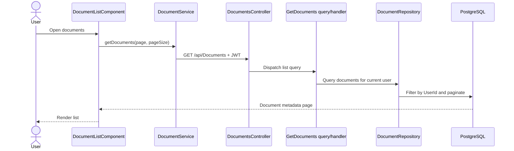

## 10.2 Deletion diagram

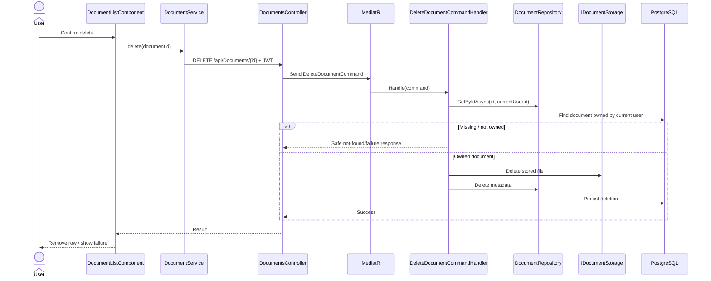

## 10.3 Source-file register

| Ref | File | Responsibility |
|---|---|---|
| [DOC-LIST-01] | `frontend/src/app/features/documents/pages/document-list/document-list.component.ts` | Document list and delete UI |
| [DOC-LIST-02] | `frontend/src/app/core/services/document.service.ts` | List and delete calls |
| [DOC-LIST-03] | `backend/API/Controllers/DocumentsController.cs` | List and delete endpoints |
| [DOC-LIST-04] | `backend/Application/Features/Documents/Queries/GetDocuments/` | List query and handler |
| [DOC-LIST-05] | `backend/Application/Features/Documents/Commands/DeleteDocument/DeleteDocumentCommandHandler.cs` | Ownership check and deletion coordination |
| [DOC-LIST-06] | `backend/Infrastructure/Repositories/DocumentRepository.cs` | User-scoped metadata queries |
| [DOC-LIST-07] | [DOC-UP-07], [DOC-UP-08] | Storage abstraction and implementation |
| [DOC-LIST-08] | [BASE-17], [BASE-20] | Database mapping/migrations |

## 10.4 Necessary theory and implementation notes

The deletion workflow spans the file system and database, so partial failure is possible. The exact current order is important: if file deletion succeeds and metadata deletion fails, the database may point to a missing file; if the reverse order were used, an orphaned file could remain. Record the observed behavior and decide whether compensation/reconciliation is needed based on actual failure modes.

## 10.5 Verification checklist

- [ ] Verify the list returns only documents owned by the signed-in user.
- [ ] Verify pagination and empty-state behavior.
- [ ] Delete an owned document and verify the file and metadata are removed as intended.
- [ ] Try deleting a different user’s document ID.
- [ ] Test missing file and database failure behavior safely.
- [ ] Verify DocumentContent deletion/cascade behavior against current migration and database schema.

**Status:** ownership checks were observed in relevant handler paths; exact failure consistency and cascade behavior require runtime/schema verification.

---

## 10.6 Source-traced document listing/deletion findings

Direct inspection of DocumentsController, GetDocumentsQueryHandler, DocumentRepository, DeleteDocumentCommandHandler, and LocalDocumentStorage confirms:

- Document listing uses the authenticated user ID in DocumentRepository.GetPagedAsync and orders by UploadedAt descending. The API returns paged metadata, not document bytes.
- DeleteDocumentCommandHandler verifies ownership by resolving the document with both ID and current user ID before attempting deletion.
- The delete sequence removes the physical file first and then deletes metadata from PostgreSQL. If the database delete fails after the file is removed, metadata can remain while the file is missing. Reversing the order creates the opposite orphan window; a more robust cleanup/reconciliation strategy is a later reliability improvement.
- DocumentContentRepository and any related AIJob records require deliberate relationship/cascade review. Do not assume deleting document metadata automatically removes extracted content and summary jobs; inspect the current migrations and foreign-key configuration during stabilization.
- The frontend refreshes the list after a successful delete and asks for confirmation before issuing the DELETE request.

## 10.7 Expanded final verification checklist

- [ ] Verify pagination, ordering and total count across multiple pages.
- [ ] Verify one user cannot list, download or delete another user’s documents.
- [ ] Verify confirmation cancellation does not call the delete endpoint.
- [ ] Verify a successful delete removes the expected file, metadata and related content according to the chosen retention policy.
- [ ] Simulate a controlled database deletion failure and document the resulting file/metadata consistency behavior.
- [ ] Verify list state refreshes after upload and deletion, including the last item on a page.


# 11. Workflow 09 — Admin user operations

**Goal:** allow only authorized administrators to list users or create users through the administrative endpoints.

## 11.1 Sequence diagram

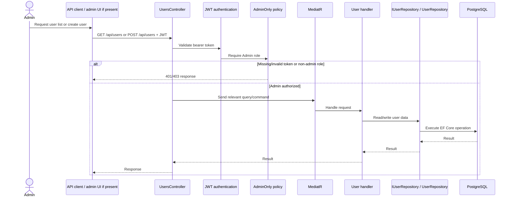

## 11.2 Source-file register

| Ref | File | Responsibility |
|---|---|---|
| [ADMIN-01] | `backend/API/Controllers/UsersController.cs` | Admin-protected endpoints |
| [ADMIN-02] | `backend/API/Extensions/AuthExtensions.cs` | AdminOnly/UserOnly role policies |
| [ADMIN-03] | Relevant user query/command handlers under `backend/Application/Features/Users/` | Use-case logic |
| [ADMIN-04] | `backend/Application/Interfaces/IUserRepository.cs` | User persistence abstraction |
| [ADMIN-05] | `backend/Infrastructure/Repositories/UserRepository.cs` | User persistence implementation |
| [ADMIN-06] | [BASE-10], [BASE-11], [BASE-17] | JWT claims, validation and database mapping |

## 11.3 Notes and verification

The current source has an AdminOnly policy on `UsersController`. Confirm every action inherits or explicitly applies the intended authorization attributes. If there is no corresponding frontend admin page, do not imply that one exists; the API can still be tested directly.

- [ ] Call each endpoint without a token, with a User-role token, and with an Admin-role token.
- [ ] Verify a normal user cannot enumerate other users.
- [ ] Verify the endpoint response does not expose password hashes or unnecessary sensitive fields.
- [ ] Verify admin-created passwords are hashed and role assignment is intentional.

**Status:** controller protection was inspected; endpoint-by-endpoint tests pending.

---

## 11.5 Source-traced admin findings

Direct inspection of UsersController confirms the controller has a class-level [Authorize(Policy = "AdminOnly")] attribute, so both user creation and user listing require the backend admin policy. The client-side route layout is not a substitute for this policy.

- The admin create endpoint accepts CreateUserCommand directly from the request body and sends it through MediatR. It returns a standard ApiResponse<Guid> on success.
- The GetUsers endpoint returns UserDto objects; inspect the DTO before runtime verification to ensure password hashes, secrets or unnecessary personal fields are not exposed.
- Admin creation reuses the CreateUser command/handler path, so duplicate-email and password-hashing behavior should be consistent with registration. The database unique-email finding from Chapter 3 still applies.
- The controller’s log messages include user IDs on successful creation, which is useful for audit tracing. Do not add passwords, JWTs, or full sensitive request bodies to logs.

## 11.6 Expanded final verification checklist

- [ ] Call GET /api/users and POST /api/users with no token, a normal User token, and an Admin token.
- [ ] Verify only an Admin can list users or create users.
- [ ] Inspect UserDto fields and confirm no password hash or sensitive authentication data is returned.
- [ ] Verify admin-created users receive the expected role and password handling.
- [ ] Verify duplicate-email failure is consistent with public registration.
- [ ] Verify audit logs are useful without exposing credentials or sensitive request content.


# 12. Workflow 10 — Health checks and operational diagnostics

## 12.1 Diagram

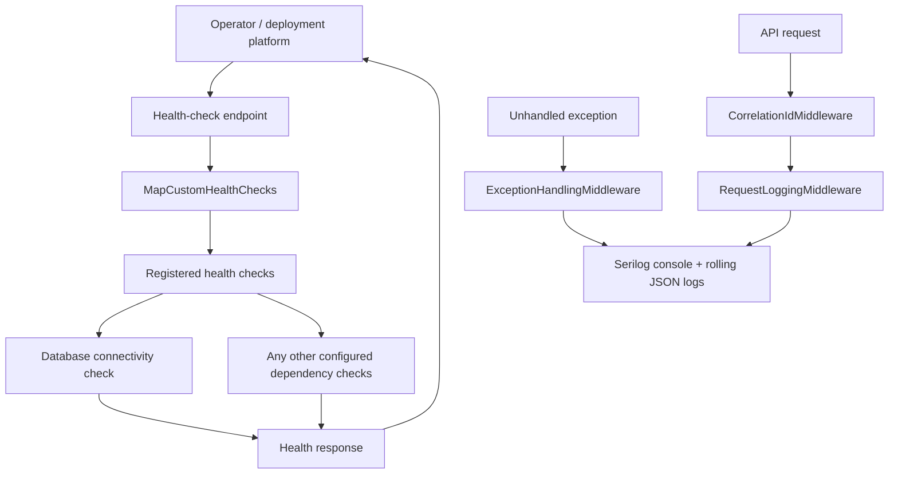

## 12.2 Source-file register

| Ref | File | Responsibility |
|---|---|---|
| [OPS-01] | `backend/API/Extensions/HealthCheckExtensions.cs` | Health-check registration/mapping |
| [OPS-02] | `backend/API/Program.cs` | Bootstrap, logging sinks and health registration |
| [OPS-03] | [BASE-02], [BASE-06], [BASE-07] | Exception handling, correlation and request logs |
| [OPS-04] | `backend/Infrastructure/DependencyInjection.cs` | Runtime dependencies and hosted worker registration |

Health checks only prove the conditions they actually test. Do not infer Redis, Gemini, worker liveness, or storage readiness is covered until inspecting the registered checks. Likewise, a successful HTTP response from the API does not necessarily prove background generation is healthy.

- [ ] Call the configured health endpoints and record exact status/payload.
- [ ] Test database unavailable behavior in a controlled local environment.
- [ ] Determine which dependencies are included in readiness/liveness checks.
- [ ] Confirm logs include correlation ID, request path/status/duration, and exception details without logging passwords, bearer tokens, or full sensitive document content.

**Status:** registration/mapping location identified; exact check list and runtime behavior pending.

---

## 12.5 Source-traced health and diagnostics findings

Direct inspection of HealthCheckExtensions and Program.cs confirms:

- /health/live runs the Self health check and indicates that the process can answer a health request; it does not prove database readiness.
- /health/ready runs the PostgreSQL readiness check registered through AddNpgSql.
- /health/details returns a JSON report containing check names/statuses and exception messages. It is mapped separately from the controller rate-limited endpoint mapping.
- Redis is configured as a required connection string at startup, but the inspected custom health-check registration does not include a Redis health check or Gemini-provider check. A healthy readiness response therefore should not be interpreted as proof that Redis or the external AI provider is healthy.
- Detailed health output may expose exception messages. Restrict detailed diagnostics appropriately before exposing this endpoint in a public production environment.
- Startup fails fast when the database or Redis connection-string setting is absent. Validate production configuration and secret injection before deploying.
- Program.cs applies the configured concurrency limiter to mapped controllers and the fixed-window limiter to endpoints explicitly decorated for it. Confirm the desired policies on every expensive endpoint rather than assuming all controllers share the same fixed-window policy.

## 12.6 Expanded final verification checklist

- [ ] Verify /health/live responds when the process is running even if PostgreSQL is unavailable.
- [ ] Verify /health/ready changes status when PostgreSQL is unavailable.
- [ ] Verify /health/details reports expected checks and is not publicly overexposed.
- [ ] Verify Redis configuration/startup failure behavior and decide whether Redis should have a health check.
- [ ] Verify missing connection strings and missing AI credentials fail with clear, non-secret-leaking diagnostics.
- [ ] Verify controller concurrency and fixed-window rate limits under safe local load.
- [ ] Verify logs contain correlation IDs and do not include tokens, passwords, or raw sensitive prompts.


# 13. Verification checklist and known limitations

This list separates facts already observed in source from behavior still to be verified.

## 13.1 Known architectural facts

- The application is one unified dashboard, not several separately managed AI projects.
- Text generation is asynchronous through a persisted AI job, in-memory queue, and hosted worker.
- Plain-text and document summarization are currently synchronous.
- PostgreSQL stores user/job/document metadata and extracted document text.
- Original documents currently use local storage through an abstraction.
- Redis is used for AI-result caching.
- The currently registered AI provider is Gemini. An OpenAI provider class exists, but automatic fallback is not registered in the inspected DI configuration.
- The in-memory queue is not a durable distributed queue. Database recovery is a mitigation, not an exactly-once guarantee.
- The inspected job-store queries scope job history/status/statistics by user; the latest document-summary lookup scopes by document and user. Document handlers inspected verify ownership before content/file operations.
- The Document Details page has a known scalability/correctness weakness because it searches a fetched page of up to 100 documents for metadata.

## 13.2 Not yet proven by this document

- That every workflow passes end-to-end in the current local environment.
- That all error status codes and response payloads match the UI’s assumptions.
- That every external AI call uses the named Polly-configured HTTP client.
- That every database relation/deletion cascade matches the logical UML.
- That every health check covers every required dependency.
- That background job retry/recovery behavior is correct under all crash timings.
- That all project-prototype references have been removed; this must be done by searching the full current codebase and migrations before a schema change.
- That the PDF extraction implementation supports OCR/scanned documents.
- That no security defect exists outside the focused ownership paths described here.

## 13.3 Final verification tracker

| Workflow | Source traced | Runtime verified | Notes |
|---|---|---|---|
| Signup/login | Source traced | Pending | Verify duplicate email, JWT, route guards and API authorization |
| Text generation | Source traced | Pending | Verify status transitions, polling, retries, restart recovery |
| Plain-text summary | Source traced | Pending | Verify immediate UI update and persisted job state |
| Upload/preview | Source traced | Pending | Verify file/metadata consistency and ownership |
| Text extraction | Source traced | Pending | Verify PDF edge cases and UI update |
| Document summary | Source traced | Pending | Verify saved summary reload and immediate rendering |
| Job history/status/stats | Source traced | Pending | Verify user isolation and enum contract |
| Document list/delete | Source traced | Pending | Verify cross-resource failure behavior/cascade |
| Admin user operations | Source traced | Pending | Verify each endpoint and returned fields |
| Health/diagnostics | Source traced | Pending | Inspect checks and exercise dependency failures |

---

# 14. Workflow source-file index

This index is deliberately broad; the workflow tables above identify the files that participate in a particular execution path.

## API / host
- `backend/API/Program.cs`
- `backend/API/Controllers/AuthController.cs`
- `backend/API/Controllers/UsersController.cs`
- `backend/API/Controllers/AIController.cs`
- `backend/API/Controllers/DocumentsController.cs`
- `backend/API/Middlewares/ExceptionHandlingMiddleware.cs`
- `backend/API/Middlewares/CorrelationIdMiddleware.cs`
- `backend/API/Middlewares/RequestLoggingMiddleware.cs`
- `backend/API/Extensions/AuthExtensions.cs`
- `backend/API/Extensions/HealthCheckExtensions.cs`

## Application
- `backend/Application/DependencyInjection.cs`
- `backend/Application/Common/Behaviors/ValidationBehavior.cs`
- `backend/Application/Common/Models/ApiResponse.cs`
- `backend/Application/Common/Exceptions/`
- `backend/Application/Interfaces/`
- `backend/Application/Features/Auth/`
- `backend/Application/Features/Users/`
- `backend/Application/Features/AI/`
- `backend/Application/Features/Documents/`

## Core
- `backend/Core/Entities/User.cs`
- `backend/Core/Entities/AIJob.cs`
- `backend/Core/Entities/Document.cs`
- `backend/Core/Entities/DocumentContent.cs`
- `backend/Core/Constants/`
- AI job type/status enums under `backend/Core/`

## Infrastructure
- `backend/Infrastructure/DependencyInjection.cs`
- `backend/Infrastructure/Data/AppDbContext.cs`
- `backend/Infrastructure/Migrations/`
- `backend/Infrastructure/Repositories/UserRepository.cs`
- `backend/Infrastructure/Repositories/DocumentRepository.cs`
- `backend/Infrastructure/Repositories/DocumentContentRepository.cs`
- `backend/Infrastructure/Services/AIJobStore.cs`
- `backend/Infrastructure/Services/AIQueue.cs`
- `backend/Infrastructure/AI/AiService.cs` (class name: `AiService`)
- `backend/Infrastructure/Services/CacheService.cs`
- `backend/Infrastructure/Services/CurrentUserService.cs`
- `backend/Infrastructure/BackgroundServices/AIWorker.cs`
- `backend/Infrastructure/Storage/LocalDocumentStorage.cs`
- `backend/Infrastructure/DocumentProcessing/PdfTextExtractor.cs`
- `backend/Infrastructure/AI/Providers/GeminiProvider.cs`
- `backend/Infrastructure/AI/Providers/OpenAIProvider.cs`
- `backend/Infrastructure/Resilience/AIResiliencePolicy.cs`

## Frontend
- `frontend/src/main.ts`
- `frontend/src/app/app.config.ts`
- `frontend/src/app/app.routes.ts`
- `frontend/src/app/core/guards/`
- `frontend/src/app/core/interceptors/`
- `frontend/src/app/core/services/`
- `frontend/src/app/core/models/`
- `frontend/src/app/features/auth/`
- `frontend/src/app/features/ai/`
- `frontend/src/app/features/dashboard/`
- `frontend/src/app/features/documents/`
- `frontend/src/app/shared/`

---

## Change-control rule

Whenever a source change alters a route, command/query, handler, interface, provider, persistence model, middleware order, status transition, or workflow behavior:

1. Update the relevant sequence diagram and file register.
2. Update the shared foundation only if a cross-cutting behavior changed.
3. Record the runtime test performed and its observed result.
4. Revisit the master walkthrough if the system path changed.
5. Do not label a workflow “verified” based only on a successful build or a diagram review.
