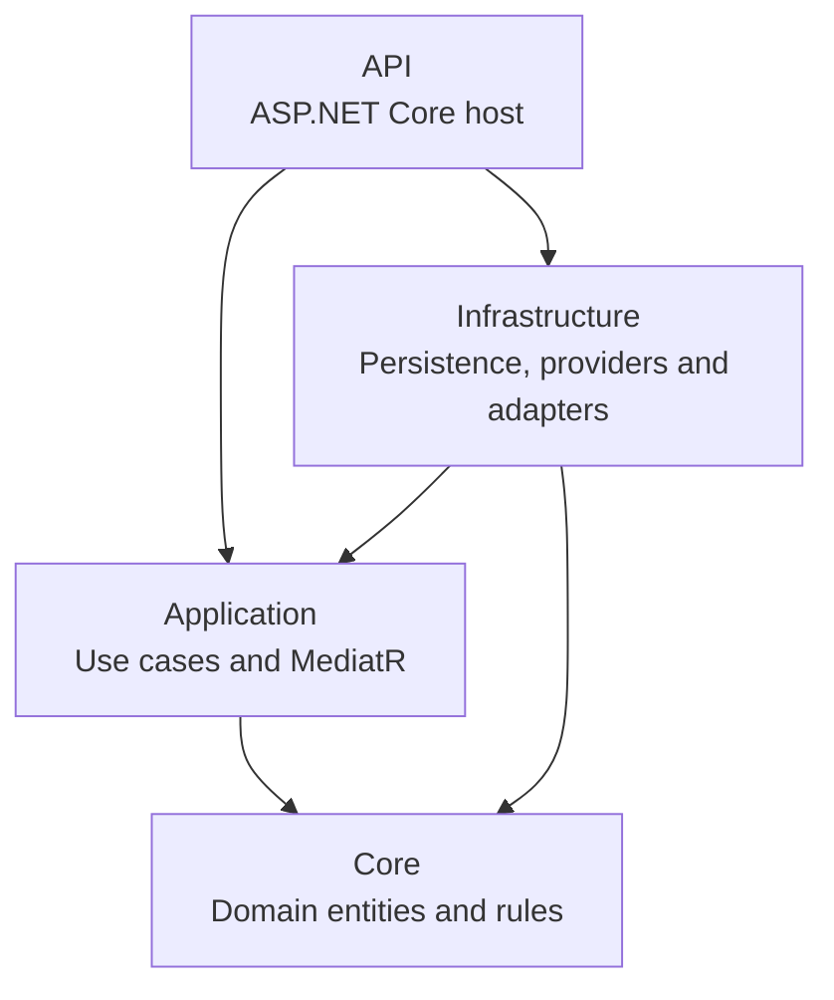

<!-- Generated by scripts/check_architecture_docs.py; do not edit manually. -->
# Generated .NET Project Dependency Map

Generated from ProjectReference entries in the backend .csproj files. Arrows mean compile-time project references, not runtime request direction.

